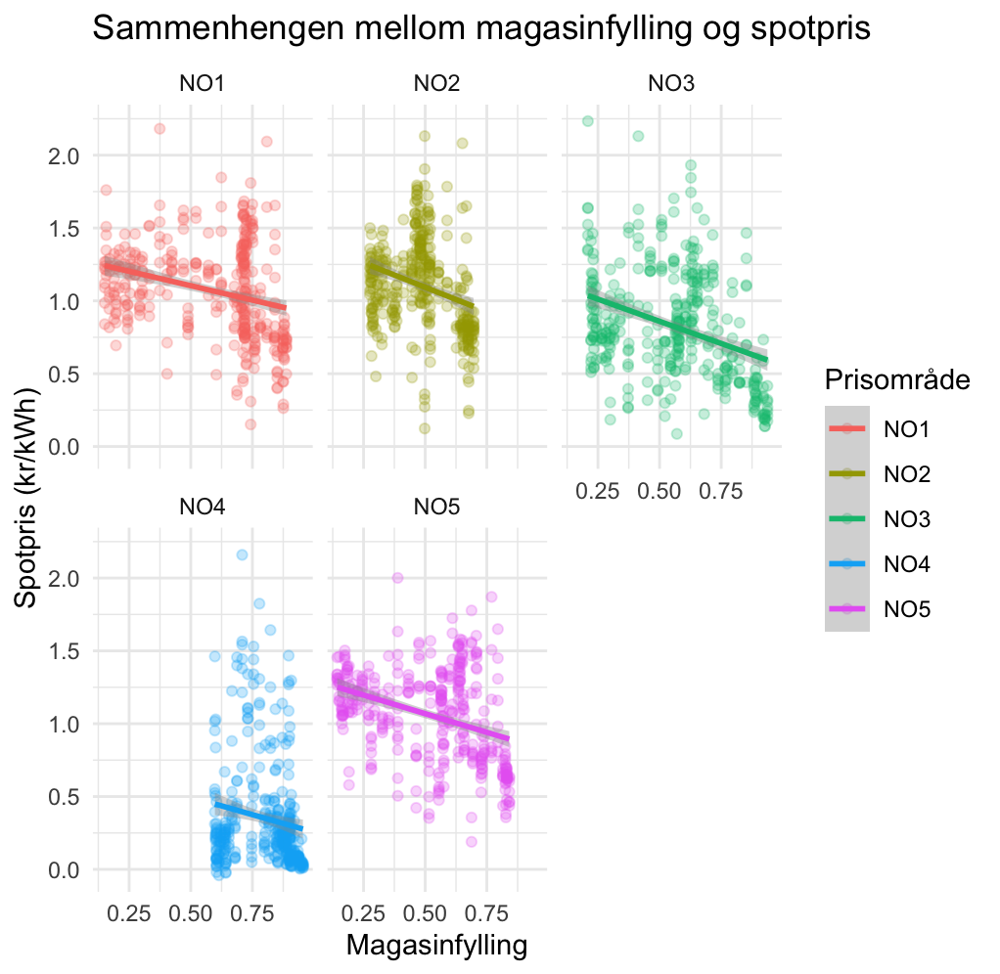

```{r}
#| include: false

# Pakker for databehandling
library(tidyverse)
library(readr)
library(readxl)
library(lubridate)
library(purrr)
library(dplyr)

# Pakker for regresjon og statistisk analyse
library(glmnet)
library(tidymodels)
library(broom)

# Pakker for tabeller
library(knitr)
```

## Abstract

\[Abstract: 3–5 setninger\]

## 1. Introduksjon og objektiv

Strømprisene i Norge har hatt betydelige svingninger de siste årene, særlig mellom de ulike prisområdene. I 2021 nådde strømprisene historiske nivåer, spesielt i Sør-Norge (NO1 og NO2). Dette ble blant annet knyttet til høye kraftpriser i Europa og lavere magasinfylling enn normalt [@skaansar_kraftaret_2022]. Som følge av prisutviklingen innførte regjeringen strømstøtte i desember 2021 [@statsministerens_kontor_regjeringen_2021]. Prisvolatiliteten fortsatte i 2022 og bidro til at flere husholdninger reduserte strømforbruket sitt [@aanensen_statistikk_2026; @aanensen_lavere_2026; @kampevoll_prisen_2026].

Den 1. oktober 2025 innførte regjeringen Norgespris, en frivillig fastprisordning for strøm og fjernvarme. Ordningen ga husholdninger mulighet til å velge en fastpris på 40 øre/kWh ekskl. mva., med formål om å gi større forutsigbarhet i møte med volatile kraftpriser [@energidepartementet_norgespris_2025]. I oktober 2026 ble det besluttet at ordningen videreføres i 2027, med en justert pris på 45 øre/kWh ekskl. mva. [@energidepartementet_norgespris_2026].

Formålet med oppgaven er å undersøke sammenhengen mellom Norgespris, strømpriser og husholdningenes strømforbruk i Norge.

**Vi undersøker følgende problemstillinger:**

1.  Hvordan varierer strømforbruket mellom husholdninger med og uten Norgespris?

2.  Hvordan henger utviklingen i strømprisene sammen med husholdningenes adopsjon av Norgespris?

3.  I hvilken grad kan fyllingsgraden i norske vannmagasiner bidra til å forklare variasjoner i strømprisene?

Analysen bygger på data fra Nord Pool, Elhub og Norges vassdrags- og energidirektorat (NVE). Vi kombinerer deskriptiv statistikk og grafisk fremstilling med statistiske analyser og regresjonsmodeller for å undersøke utviklingstrekk og sammenhenger i datamaterialet.

## 2. Databehandling og implementering

Hele databehandlingsprosessen og de empiriske analysene er gjennomført i R. Analysen benytter sekundærdata fra tre sentrale aktører i det norske og nordiske kraftmarkedet:

1.  Elhub: Daglige data for aggregert strømforbruk (kWh), antall målepunkter og Norgespris-adopsjon, fordelt på prisområdene NO1–NO5 og forbruksgruppene husholdning og fritidsbolig [@sannes_norgespris_2026; @sannes_norgespris_2026-1; @stokke_hammer-dybvad_forbruk_2026].

2.  Norges vassdrags- og energidirektorat (NVE): Ukentlige data for fyllingsgraden i norske vannmagasiner [@norges_vassdrag_og_energidirektorat_magasinstatistikk_2026].

3.  Nord Pool: Daglige aggregerte spotpriser for perioden 2020–2026 og timepriser for perioden 1. oktober 2025–30. september 2026 [@nordpool_price_2026; @nordpool_prices_2026].

Rådataene er levert i CSV- og Excel-format og bearbeidet i R. Datasettene er deretter kombinert til et felles datagrunnlag for analysene.

### 2.1 Nord Pool

Fra Nord Pool benytter vi daglige aggregerte spotpriser for de fem norske prisområdene (NO1–NO5) i perioden 2020–30. september 2026. I tillegg benyttes timebaserte spotpriser for perioden 1. oktober 2025–30. september 2026. **\<- sjekk dette Emily.**

Prisdataene ble lastet ned i separate Excel-filer og importert til R ved hjelp av `readxl`. Filene ble kombinert til samlede datasett. Metadata og "NA" observasjoner fjernet. Datoene ble standardisert og sortert kronologisk. Timeprisene ble tilsvarende kombinert.

Spotprisene er opprinnelig oppgitt i NOK/MWh og konvertert til NOK/kWh ved å dele på 1000. Dette gir sammenlignbare måleenheter på tvers av data. \<- **Em, dobbelsjekk at vi trenger dette**

For timeprisene ble daglige oppsummeringsverdier (minimum, maksimum og gjennomsnitt) skilt fra de ordinære timeobservasjonene for å unngå at ulike tidsoppløsninger blandes i analysene.

```{r}
#| include: false

# Mapper med Nord Pool-data
mappe_nordpool <- "data-kilde/Nordpool_2025_2026"

filer_nordpool <- list.files(
  path = mappe_nordpool,
  pattern = "\\.xlsx$",
  full.names = TRUE,
  ignore.case = TRUE
)

# Leser og kombinerer alle timeprisfilene
priser_per_time <- map_dfr(filer_nordpool, function(fil) {

  dato <- str_extract(
    basename(fil),
    "\\d{4}-\\d{2}-\\d{2}"
  )

  read_excel(fil, skip = 4) |>
    mutate(Date = as.Date(dato)) |>
    select(-2) |>
    rename(hour = `Delivery period (CET)`) |>
    relocate(Date, hour) |>
    mutate(
      across(starts_with("NO"), ~ .x / 1000)
    )
})

# Skiller ut daglige oppsummeringsverdier
dognstatistikk_w <- priser_per_time |>
  filter(hour %in% c("Min:", "Max:", "Average:")) |>
  rename(Statistic = hour) |>
  pivot_wider(
    names_from = Statistic,
    values_from = starts_with("NO")
  )

# Lager døgnstatistikk i langt format
dognstatistikk <- priser_per_time |>
  filter(hour %in% c("Min:", "Max:", "Average:")) |>
  rename(Statistic = hour) |>
  pivot_longer(
    cols = starts_with("NO"),
    names_to = "Price_area",
    values_to = "Price"
  )

# Fjerner døgnoppsummeringene fra timeprisdataene
timepriser <- priser_per_time |>
  filter(!hour %in% c("Min:", "Max:", "Average:"))
```

### 2.2 Elhub – Norgespris og strømforbruk

Dataene ble importert fra CSV-filer og omstrukturert fra bredt til langt format for å aggregere undergruppene til samlevariabler for husholdninger og fritidsboliger. På bakgrunn av disse ble det beregnet andeler av målepunkter med Norgespris og andeler av strømforbruket som dekkes av ordningen.

Utdrag av funksjon for å samle og sortere data for norgespris og strømforbruk.

```{r}
#| eval: false
#| echo: true

# Finn alle Excel-filer i mappen
beregn_prisområde <- function(data, omrade_navn) {
  data |>
    filter(PRISOMRÅDE == omrade_navn) |>
    pivot_wider(
      names_from = c(EAC_GRUPPE, FORBRUKSGRUPPE),
      values_from = c(ANTALL_NORGESPRIS, ANTALL, FORBRUK, FORBRUK_NORGESPRIS),
      values_fill = 0  # Sørger for at manglende grupper blir 0 i stedet for NA
    ) |>
    #rowwise() |>
    #mutate(
    #ungroup() 
# }

# 2. Henter ut de 5 tabellene
# 3. Beregn én samlet tabell og splitt i 5 deltabeller

```

Det er viktig å merke seg at antall målepunkter ikke nødvendigvis tilsvarer antall husholdninger, ettersom én husholdning kan disponere flere målepunkter.

### 2.3 Konstruksjon av reell sluttpris og strømstøtte

For å undersøke hvilke prissignaler husholdningene står overfor, beregnes en estimert sluttpris etter strømstøtte. Spotprisen alene gir ikke et fullstendig bilde av husholdningenes faktiske priskostnad, ettersom staten har gitt strømstøtte siden desember 2021.

Sluttprisen beregnes ved å trekke beregnet strømstøtte fra spotprisen. Beregningen tar hensyn til historiske endringer i støtteordningens dekningsgrad og innslagsterskel. Fra desember 2021 var støttesatsen først 55 %, før den ble økt til 80 % og senere 90 %. Innslagsterskelen ble gradvis justert fra 70 øre/kWh til 77 øre/kWh i 2026.

Videre konstrueres Norgespris som en referansepris på 40 øre/kWh ekskl. mva. (50 øre inkl. mva.) fra 1. oktober 2025.

Utdrag av funksjon for støtteutregner få vise datawrangling og utregning av ny data.

```{r}
#| eval: false
#| echo: true

# Forutsetter 'strompriser' (fra 2.2) eller 'dognstatistikk_w' (fra 2.3)
stotteutregner <- function(cc) {  
  cc |> 
    mutate(
      across(
        .cols = starts_with("NO"),
        .fns = ~ case_when(
          Date < as.Date("2021-12-01") ~ 0,
          Date < as.Date("2022-01-01") & .x >= 0.70 ~ (.x - 0.70) * 0.55,
          Date < as.Date("2022-09-01") & .x >= 0.70 ~ (.x - 0.70) * 0.80,
          Date < as.Date("2024-01-01") & .x >= 0.70 ~ (.x - 0.70) * 0.90,
          Date < as.Date("2025-01-01") & .x >= 0.73 ~ (.x - 0.73) * 0.90,
          Date < as.Date("2026-01-01") & .x >= 0.75 ~ (.x - 0.75) * 0.90,
          Date >= as.Date("2026-01-01") & .x >= 0.77 ~ (.x - 0.77) * 0.90,
          TRUE ~ 0
        ), 
        .names = "stotte_{.col}"
      )
    ) |> 
    # Beregner sluttpris per prisområde
   
    # Legger til Norgespris
  #return(cc_ny)
```

### 2.4 NVE – fyllingsgrad i vannmagasiner

For å undersøke sammenhengen mellom magasinfylling og strømpriser benytter vi ukentlige data fra NVE for perioden 2020–2026, fordelt på de fem norske prisområdene. Fyllingsgraden gir informasjon om tilgjengelig vannkraftressurs og kan påvirke produsentenes vannverdier og forventninger om fremtidig krafttilgang.

Excel-filene ble importert og bearbeidet i R. Dataene ble omstrukturert fra bredt til langt format, slik at hver observasjon representerer fyllingsgraden for et gitt prisområde og en bestemt uke. Datasettene ble deretter kombinert til et samlet datasett basert på år, uke og prisområde.

## 3. Metode

Analysen kombinerer ordinær lineær regresjon (OLS) med faste effekter og regularisert regresjon (LASSO) for å undersøke statistiske sammenhenger og modellens prediksjonsevne. Databehandling og modellering er gjennomført i R, med Tidyverse og Tidymodels som sentrale rammeverk [@wickham_r_2016; @kuhn_tidy_2023].

Valget av estimeringsmetoder bygger på skillet mellom økonomisk parameterestimering og prediksjon [@athey_machine_2019; @hammersmark_econ3170_2026].

```{r}
#| include: false 


# 1. ELHUB - IMPORT OG BEARBEIDING AV MÅLERDATA

filer_maaler <- list.files(
  path = "data-kilde/maaler",
  pattern = "\\.(xls|xlsx|csv)$",
  full.names = TRUE,
  ignore.case = TRUE
)

maalerdata <- map_dfr(filer_maaler, function(fil) {
  
  if (grepl("\\.csv$", fil, ignore.case = TRUE)) {
    read_csv2(fil, show_col_types = FALSE)
  } else {
    read_excel(fil)
  }
  
}) |>
  rename(Date = DATO)


# Funksjon for å aggregere målerdata per prisområde

beregn_prisområde <- function(data, omrade_navn) {
  
  data |>
    filter(PRISOMRÅDE == omrade_navn) |>
    pivot_wider(
      names_from = c(EAC_GRUPPE, FORBRUKSGRUPPE),
      values_from = c(
        ANTALL_NORGESPRIS,
        ANTALL,
        FORBRUK,
        FORBRUK_NORGESPRIS
      ),
      values_fill = 0
    ) |>
    rowwise() |>
    mutate(
      sum_hus_NP = sum(
        c_across(starts_with("ANTALL_NORGESPRIS_HUSHOLDNING")),
        na.rm = TRUE
      ),
      sum_fri_NP = sum(
        c_across(starts_with("ANTALL_NORGESPRIS_FRITID")),
        na.rm = TRUE
      ),
      sum_hus_tot = sum(
        c_across(starts_with("ANTALL_HUSHOLDNING")),
        na.rm = TRUE
      ),
      sum_fri_tot = sum(
        c_across(starts_with("ANTALL_FRITID")),
        na.rm = TRUE
      ),
      forbruk_hus = sum(
        c_across(starts_with("FORBRUK_HUSHOLDNING")),
        na.rm = TRUE
      ),
      forbruk_fri = sum(
        c_across(starts_with("FORBRUK_FRITID")),
        na.rm = TRUE
      ),
      forbruk_hus_NP = sum(
        c_across(starts_with("FORBRUK_NORGESPRIS_HUSHOLDNING")),
        na.rm = TRUE
      ),
      forbruk_fri_NP = sum(
        c_across(starts_with("FORBRUK_NORGESPRIS_FRITID")),
        na.rm = TRUE
      )
    ) |>
    ungroup() |>
    mutate(
      prosent_hus_NP = sum_hus_NP / sum_hus_tot,
      prosent_fri_NP = sum_fri_NP / sum_fri_tot,
      prosent_forbruk_hus_NP = forbruk_hus_NP / forbruk_hus,
      prosent_forbruk_fri_NP = forbruk_fri_NP / forbruk_fri
    )
}


# Samler alle fem prisområdene

omraader <- c("NO1", "NO2", "NO3", "NO4", "NO5")

maal_samlet <- map_dfr(
  omraader,
  ~ beregn_prisområde(maalerdata, .x)
) |>
  as_tibble()


# 2. NORD POOL - TIMEPRISER

mappe <- "data-kilde/Nordpool_2025_2026"

filer_nordpool <- list.files(
  path = mappe,
  pattern = "\\.xlsx$",
  full.names = TRUE,
  ignore.case = TRUE
)

length(filer_nordpool)


# Leser og kombinerer alle timeprisfilene

priser_per_time <- map_dfr(filer_nordpool, function(fil) {
  
  dato <- str_extract(
    basename(fil),
    "\\d{4}-\\d{2}-\\d{2}"
  )
  
  read_excel(fil, skip = 4) |>
    mutate(Date = as.Date(dato)) |>
    select(-2) |>
    rename(hour = `Delivery period (CET)`) |>
    relocate(Date, hour) |>
    mutate(
      across(starts_with("NO"), ~ .x / 1000)
    )
})


# Skiller ut daglige oppsummeringsverdier

dognstatistikk <- priser_per_time |>
  filter(hour %in% c("Min:", "Max:", "Average:")) |>
  rename(Statistic = hour) |>
  pivot_longer(
    cols = starts_with("NO"),
    names_to = "Price_area",
    values_to = "Price"
  )


# Lager døgnstatistikk i bredt format

dognstatistikk_w <- priser_per_time |>
  filter(hour %in% c("Min:", "Max:", "Average:")) |>
  rename(Statistic = hour) |>
  pivot_wider(
    names_from = Statistic,
    values_from = starts_with("NO")
  )


# Fjerner Min, Max og Average fra timeprisdataene

timepriser <- priser_per_time |>
  filter(!hour %in% c("Min:", "Max:", "Average:"))


# 3. STRØMSTØTTE OG NORGESPRIS

stotteutregner <- function(cc) {
  
  cc_ny <- cc |>
    mutate(
      across(
        .cols = starts_with("NO"),
        .fns = ~ case_when(
          
          # Før strømstøtten
          Date < as.Date("2021-12-01") ~ 0,
          
          # Desember 2021: 55 prosent
          Date < as.Date("2022-01-01") &
            Date >= as.Date("2021-12-01") &
            .x >= 0.70 ~ (.x - 0.70) * 0.55,
          
          # Januar-mars 2022: 80 prosent
          Date < as.Date("2022-04-01") &
            Date >= as.Date("2022-01-01") &
            .x >= 0.70 ~ (.x - 0.70) * 0.80,
          
          # April-august 2022: 80 prosent
          Date < as.Date("2022-09-01") &
            Date >= as.Date("2022-04-01") &
            .x >= 0.70 ~ (.x - 0.70) * 0.80,
          
          # September-desember 2022: 90 prosent
          Date < as.Date("2023-01-01") &
            Date >= as.Date("2022-09-01") &
            .x >= 0.70 ~ (.x - 0.70) * 0.90,
          
          # Januar-september 2023
          Date < as.Date("2023-10-01") &
            Date >= as.Date("2023-01-01") &
            .x >= 0.70 ~ (.x - 0.70) * 0.90,
          
          # Oktober-desember 2023
          Date < as.Date("2024-01-01") &
            Date >= as.Date("2023-10-01") &
            .x >= 0.70 ~ (.x - 0.70) * 0.90,
          
          # 2024
          Date < as.Date("2025-01-01") &
            Date >= as.Date("2024-01-01") &
            .x >= 0.73 ~ (.x - 0.73) * 0.90,
          
          # 2025
          Date < as.Date("2026-01-01") &
            Date >= as.Date("2025-01-01") &
            .x >= 0.75 ~ (.x - 0.75) * 0.90,
          
          # 2026
          Date >= as.Date("2026-01-01") &
            .x >= 0.77 ~ (.x - 0.77) * 0.90,
          
          TRUE ~ 0
        ),
        .names = "stotte_{.col}"
      )
    ) |>
    
    # Beregner sluttpris etter strømstøtte
    mutate(
      across(
        .cols = starts_with("NO"),
        .fns = ~ .x - pick(
          paste0("stotte_", cur_column())
        )[[1]],
        .names = "slutt_{.col}"
      )
    ) |>
    
    # Konstruerer Norgespris
    mutate(
      Norgespris_uMVA = case_when(
        Date < as.Date("2025-10-01") ~ 0,
        TRUE ~ 0.4
      ),
      Norgespris_mMVA = case_when(
        Date < as.Date("2025-10-01") ~ 0,
        TRUE ~ 0.5
      )
    )
  
  return(cc_ny)
}


# 4. NVE - FYLLINGSGRAD I VANNMAGASINER

filer <- list.files(
  "data-kilde/fylling",
  pattern = "\\.(xls|xlsx|csv)$",
  full.names = TRUE
)

#length(filer)


# Les inn filene, og formatter dem slika t de er på ønsket format
data_liste <- lapply(filer, function(fil) {
  
  #mellomlagrer formatert filnavn slik at den kan brukes som tittel på kolonne
  navn <- basename(fil)|>
    str_remove("\\, 2020, 2021, 2022, 2023, 2024, 2025, 2026.xlsx")
  
  read_excel(fil,skip = 2, col_names = TRUE)[,c(1,5:11)]|>
    #fjerner tegn slik at års.label kan brukes som verdi
  rename_with(~ str_extract(.x, "\\d{4}"), .cols = -Uke)|> 
    arrange(Uke) |> pivot_longer(
      cols = -Uke,
      names_to = "år",
      values_to = navn
    )|>
    mutate(år = as.numeric(år))|>
    arrange(år, Uke)
})

#formattering av det endelige resultatet
fyll_2020_2026 <- data_liste |> 
  reduce(inner_join, by = c("Uke", "år"))|>
  drop_na() |>
  relocate(år, Uke)

# Omformer til langt format og legger til dato
fyll_2020_2026 <- fyll_2020_2026 |>
  pivot_longer(
    cols = -c(år, Uke),
    names_to = "PRISOMRÅDE",
    values_to = "fyllingsgrad"
  ) |>
  mutate(
    PRISOMRÅDE = str_extract(PRISOMRÅDE, "NO\\d+"),
    Date = ISOweek::ISOweek2date(
      sprintf("%d-W%02d-1", år, Uke)
    )
  ) |>
  select(Date, år, Uke, PRISOMRÅDE, fyllingsgrad) |>
  arrange(PRISOMRÅDE, Date)


# 5. SAMMENSTILLING AV ALLE DATA

omraader <- c("NO1", "NO2", "NO3", "NO4", "NO5")

maal_samlet <- map_dfr(omraader, ~ beregn_prisområde(maalerdata, .x)) |> 
  as_tibble()


# 2. PRISER OG STRØMSTØTTE: Beregner og omformer til langt panelformat

# Kjører støtteberegningen på dagsdataene
dogn_stotte <- stotteutregner(dognstatistikk_w)

names(dogn_stotte)

view(dogn_stotte)

# Endrer kolonnenavnene for spotpris så de blir entydige før pivotering
priser_long <- dogn_stotte |> 
  rename_with(
    ~ paste0("spotpris_", .x),
    .cols = matches("^NO\\d+ \\(NOK\\)")
  ) |> 
  pivot_longer(
    cols = matches("^(spotpris_|stotte_|slutt_)"),
    names_to = c("PRISTYPE", "PRISOMRÅDE", "MÅLING"),
    names_pattern = "^(spotpris|stotte|slutt)_(NO\\d) \\(NOK\\)_(Min:|Max:|Average:)$",
    values_to = "VERDI"
  ) |> 
  pivot_wider(
    names_from = c(PRISTYPE, MÅLING),
    values_from = VERDI,
    names_glue = "{PRISTYPE}_{MÅLING}"
  )

view(priser_long)

# 3. MAGASINFYLLING (NVE): Henter klargjorte data

fyll_long <- fyll_2020_2026 |>
  select(Date, år, Uke, PRISOMRÅDE, fyllingsgrad)


# 4. SAMMENSTILLING: Bygger det endelige masterdatasettet

all_data_samlet <- priser_long |>
  inner_join(
    maal_samlet,
    by = c("Date", "PRISOMRÅDE")
  ) |>
  mutate(
    år = year(Date),
    Uke = isoweek(Date)
  ) |>
  left_join(
    fyll_long |>
      select(Date, PRISOMRÅDE, fyllingsgrad),
    by = c("Date", "PRISOMRÅDE")
  ) |>
  arrange(PRISOMRÅDE, Date) |>
  group_by(PRISOMRÅDE) |>
  fill(fyllingsgrad, .direction = "down") |>
  ungroup() |>
  rename(slutt_Average = `slutt_Average:`)

# 6. KONTROLL AV DET FERDIGE DATASETTET

# Antall observasjoner og variabler
dim(all_data_samlet)

# Kontroller kolonnenavn
names(all_data_samlet)

# Kontroller datoer
range(all_data_samlet$Date, na.rm = TRUE)

# Kontroller antall observasjoner per prisområde
count(all_data_samlet, PRISOMRÅDE)

# Kontroller manglende verdier i sentrale variabler
all_data_samlet |>
  summarise(
    mangler_forbruk = sum(is.na(forbruk_hus)),
    mangler_norgespris = sum(is.na(prosent_hus_NP)),
    mangler_spotpris = sum(is.na(slutt_Average)),
    mangler_fyllingsgrad = sum(is.na(fyllingsgrad))
  )


```

### 3.1 Empirisk datastruktur og paneldatamodellering

Analysen bruker det sammensatte datasettet all_data_samlet, som inneholder daglige observasjoner for de fem norske elspotområdene. For å kontrollere for regionale forskjeller og sesongvariasjoner benyttes faste effekter. Den generelle modellstrukturen er:

$y_{it} = \beta_0 + \mathbf{\beta} \mathbf{X}_{it} + \alpha_i + \delta_m + \varepsilon_{it}$

Her representerer $y_{it}$ den avhengige variabelen, mens $X_{it}$ er forklaringsvariablene. Områdefaste effekter $(\alpha_i)$ kontrollerer for tidskonstante forskjeller mellom prisområdene, mens månedsfaste effekter $(\delta_m)$ fanger opp sesongvariasjoner, blant annet knyttet til temperatur og oppvarmingsbehov.

### 3.2 Spesifikasjon av estimeringsmodellene (OLS)

Det estimeres totalt fire OLS-modeller for å undersøke oppgavens problemstillinger.

#### Norgespris og strømforbruk: Problemstilling 1

For å undersøke hvordan husholdningenes strømforbruk varierer med Norgespris-adopsjon, spesifiseres følgende modell:

$\text{forbruk\_hus}_{it} = \beta_0 + \beta_1 \text{prosent\_hus\_NP}_{it} + \beta_2 \text{slutt\_Average}_{it} + \alpha_i + \delta_m + \varepsilon_{it}$

( hvor $\text{forbruk\_hus}_{it}$ er gjennomsnittlig dagsforbruk per målepunkt (kWh), $\text{prosent\_hus\_NP}_{it}$ er andelen målepunkter med Norgespris og $\text{slutt\_Average}_{it}$ gjennomsnittlig strømpris etter strømstøtte (NOK/kWh). ) \<- fjerne?

Ettersom Norgespris er en frivillig ordning, kan husholdningenes avtalevalg være påvirket av forventet strømforbruk og prisfølsomhet. Dette gir risiko for seleksjonsskjevhet.

```{r}
#| eval: false
#| echo: true

# Estimering av OLS-modell med faste effekter for område og måned
modell_p1 <- lm(
  forbruk_hus ~ prosent_hus_NP + slutt_Average + 
    factor(PRISOMRÅDE) + factor(month(Date)),
  data = all_data_samlet
)

```

```{r}
#| include: false

# 7. OLS problemstiling 1: 

modell_p1 <- lm(
  forbruk_hus ~ prosent_hus_NP +
    slutt_Average +
    factor(PRISOMRÅDE) +
    factor(month(Date)),
  data = all_data_samlet
)

#summary(modell_p1)
```

#### **Prisdynamikk og adopsjon av Norgespris: Problemstilling 2**

For å undersøke sammenhengen mellom strømpriser, magasinfylling og husholdningenes adopsjon av Norgespris estimeres følgende modell:

$\text{prosent\_hus\_NP}_{it} = \beta_0 + \beta_1 \text{slutt\_Average}_{it} + \beta_2 \text{fyllingsgrad}_{it} + \alpha_i + \gamma t + \varepsilon_{it}$

( Her representerer `slutt_Average` gjennomsnittlig strømpris etter støtte, $\text{fyllingsgrad}_{it}$ fanger opp den ukentlige magasinfyllingen fra NVE, og $t$ en lineær tidstrend (`as.numeric(Date)`). Tidstrenden inkluderes for å kontrollere for den generelle utviklingen i Norgespris-adopsjonen over perioden. ) \<- fjerne?

```{r}
#| include: false

# Modell 2A: Kun nettopris
modell_2A <- lm(
  prosent_hus_NP ~ slutt_Average,
  data = all_data_samlet
)


#Modell 2B: Nettopris, magasinfylling og område
modell_2B <- lm(
  prosent_hus_NP ~
    slutt_Average +
    fyllingsgrad +
    factor(PRISOMRÅDE),
  data = all_data_samlet
)

# Modell 2C: Utvider med lineær tidstrend
modell_2C <- lm(
  prosent_hus_NP ~
    slutt_Average +
    fyllingsgrad +
    factor(PRISOMRÅDE) +
    as.numeric(Date),
  data = all_data_samlet
)
```

#### **Magasinfylling og spotpris: Problemstilling 3**

For å undersøke i hvilken grad magasinfyllingen kan bidra til å forklare variasjoner i spotprisene, estimeres følgende modell:

$\text{spotpris}_{it} = \beta_0 + \beta_1 \text{fyllingsgrad}_{it} + \alpha_i + \delta_{\text{uke}} + \varepsilon_{it}$

hvor $\delta_{\text{uke}}$ fanger opp historiske sesongmønstre i magasinfylling og etterspørsel.

Fyllingsgraden måles i prosent, i verdier fra 0 til 1. Områdefaste effekter kontrollerer for regionale forskjeller, mens ukefaste effekter fanger opp sesongmessige variasjoner i blant annet magasinfylling og etterspørsel.

```{r}
#| include: false
# Problemstilling 3: Magasinfylling og strømpriser

ols_fyllingsgrad <- lm(
 `spotpris_Average:` ~ fyllingsgrad +
   factor(PRISOMRÅDE) +
    as.numeric(Date),
  data = all_data_samlet
)

#summary(ols_fyllingsgrad)
```

### 3.3 Regularisert regresjon og LASSO-modellering

I tillegg til OLS benyttes LASSO-regresjon (Least Absolute Shrinkage and Selection Operator) som en alternativ estimeringsmetode. LASSO kombinerer lineær regresjon med en $L_1$ -straff som begrenser størrelsen på koeffisientene og kan sette mindre relevante koeffisienter lik null. Metoden brukes dermed til variabelseleksjon og kan redusere risikoen for overtilpasning [@tibshirani_regression_1996; @hastie_elements_2009; @fonti_feature_2017; @gentzkow_text_2019].

LASSO-modellen estimeres ved å minimere:

$\hat{\beta}_{\text{lasso}} = \arg\min_{\beta} \left( \sum_{i=1}^N \left( y_i - \beta_0 - \sum_{j=1}^p x_{ij}\beta_j \right)^2 + \lambda \sum_{j=1}^p |\beta_j| \right)$

Straffeparameteren $\lambda$ bestemmer graden av regularisering. En høyere verdi gir sterkere krymping av koeffisientene, mens en lavere verdi gjør modellen mer lik ordinær lineær regresjon.

For å evaluere prediksjonsevnen deles datamaterialet i et treningssett (80 %) og et testsett (20 %). Straffeparameteren velges gjennom 10-fold kryssvalidering på treningsdataene, med RMSE og $R^2$ som evalueringsmål. Den endelige modellen evalueres deretter på testsettet.

```{r}
#| include: false

# 8. LASSO av problemstilling 1

lasso_data <- all_data_samlet |>
  select(
    forbruk_hus,
    prosent_hus_NP,
    slutt_Average,
    PRISOMRÅDE,
    Date
  ) |>
  drop_na() |>
  mutate(
    PRISOMRÅDE = factor(PRISOMRÅDE),
    måned = factor(month(Date))
  ) |>
  select(-Date)

# Deler data i trening (80 %) og test (20 %)
set.seed(3170)

data_split <- initial_split(lasso_data, prop = 0.8)

train_data <- training(data_split)
test_data  <- testing(data_split)

# Oppretter Recipe
lasso_rec <- recipe(forbruk_hus ~ ., data = train_data) |>
  step_dummy(all_nominal_predictors()) |>
  step_zv(all_predictors()) |>
  step_normalize(all_numeric_predictors())

# Spesifiserer LASSO-modellen
lasso_spec <- linear_reg(
  penalty = tune(),
  mixture = 1
) |>
  set_engine("glmnet")

lasso_wf <- workflow() |>
  add_recipe(lasso_rec) |>
  add_model(lasso_spec)

# Kryssvalidering
folds <- vfold_cv(train_data, v = 10)

grid_lambda <- grid_regular(
  penalty(range = c(-4, 1)),
  levels = 50
)

lasso_res <- tune_grid(
  lasso_wf,
  resamples = folds,
  grid = grid_lambda,
  metrics = metric_set(rmse, rsq)
)

# Finner beste lambda
best_lambda <- select_best(
  lasso_res,
  metric = "rmse"
)

# Tester modellen på testdata
final_lasso_wf <- finalize_workflow(
  lasso_wf,
  best_lambda
)

final_lasso_fit <- last_fit(
  final_lasso_wf,
  split = data_split
)

collect_metrics(final_lasso_fit)

# Henter koeffisientene
final_model_train <- fit(
  final_lasso_wf,
  data = train_data
)

koeffisienter_lasso <- final_model_train |>
  extract_fit_parsnip() |>
  tidy() |>
  filter(estimate != 0)
```

*Metodisk merknad om valg av* $\lambda$***:** Kryssvalideringen valgte en svært lav verdi for* $\lambda$*. Dette innebærer svak regularisering, men er ikke i seg selv et tegn på overtilpasning. Modellens prediksjonsevne må vurderes ut fra resultatene på testsettet og sammenlignes med OLS [@hastie_elements_2009].*

Utdrag fra koden (inneholder kun arbeidskommentarer for å spare plass og forklare arbeidsflyt):

```{r}
#| eval: false
#| echo: true

# Deler data i trening (80 %) og test (20 %)

# Oppretter Recipe

# Spesifiserer LASSO-modellen

# velger hvor mange deler den skal ha  

set.seed(3170)

# tuner 

# finner beste lambda 

#ser at lambda er veldig veldig lav, redd dette lager en overfitted modell 

# tester modellen på testdaten 

```

## 4. Resultat og evaluering

I dette kapittelet presenteres resultatene fra de empiriske analysene. Resultatene er strukturert etter oppgavens tre problemstillinger. Først undersøkes sammenhengen mellom Norgespris-adopsjon og husholdningenes samlede strømforbruk. Deretter analyseres sammenhengen mellom strømpriser, magasinfylling og adopsjon av Norgespris. Til slutt undersøkes sammenhengen mellom magasinfylling og spotpriser i de norske prisområdene.

### 4.1 Historisk utvikling i strømpriser

Figur 4.1 viser utviklingen i gjennomsnittlige døgnpriser i de fem norske prisområdene fra 2020 til 2026. Figuren illustrerer både variasjoner i strømprisene over tid og geografiske forskjeller mellom prisområdene. Prisområdene har ikke hatt identisk prisutvikling, noe som viser betydningen av å kontrollere for geografiske forskjeller i de videre regresjonsanalysene.

{fig-align="left" width="361" height="252"}

### 4.2 Norgespris og strømforbruk: Problemstilling 1

For å undersøke sammenhengen mellom Norgespris-adopsjon og husholdningenes strømforbruk estimeres en OLS-modell med samlet husholdningsforbruk per prisområde som avhengig variabel. Modellen inkluderer andelen husholdningsmålepunkter med Norgespris, nettopris, områdefaste effekter og månedsfaste effekter.

{width="370" height="286"}

Figur 4.2 viser den deskriptive sammenhengen mellom andelen husholdningsmålepunkter med Norgespris og samlet husholdningsforbruk, fordelt på prisområde. Trendlinjene illustrerer hvordan sammenhengen varierer mellom områdene.

```{r}
#| echo: false
#| warning: false
#| message: false


# OLS
ols_tabell <- tidy(modell_p1) |>
  filter(term %in% c("prosent_hus_NP", "slutt_Average")) |>
  mutate(
    Variabel = recode(
      term,
      "prosent_hus_NP" = "Andel husholdninger med Norgespris",
      "slutt_Average" = "Spotpris"
    ),
    `OLS (koeffisient, standardfeil)` =
      sprintf("%.0f (%.0f)", estimate, std.error)
  ) |>
  select(
    Forklaringsvariabel = Variabel,
    `OLS (koeffisient, standardfeil)`
  )

# LASSO
lasso_tabell <- koeffisienter_lasso |>
  filter(term %in% c("prosent_hus_NP", "slutt_Average")) |>
  mutate(
    Variabel = recode(
      term,
      "prosent_hus_NP" = "Andel husholdninger med Norgespris",
      "slutt_Average" = "Spotpris"
    ),
    `LASSO (koeffisient)` = round(estimate, 0)
  ) |>
  select(
    Forklaringsvariabel = Variabel,
    `LASSO (koeffisient)`
  )

# Lager tabellen
tabell_41 <- left_join(ols_tabell, lasso_tabell,
                       by = "Forklaringsvariabel")

knitr::kable(
  tabell_41,
  format = "html",
  caption = "Tabell 4.1. Regresjonsresultater for modell P1",
  align = "lrr"
)

```

*Merknad: OLS-koeffisienter rapporteres med standardfeil i parentes. LASSO-koeffisientene viser estimerte koeffisienter. Alle koeffisienter er avrundet til nærmeste heltall.*

For å vurdere hvor godt modellene predikerer husholdningenes strømforbruk, sammenlignes OLS og LASSO på et felles testsett. Dette gjør det mulig å undersøke om regulariseringen i LASSO gir bedre prediksjoner enn den ordinære lineære regresjonsmodellen.

```{r}
#| include: false

# Sammenligner OLS og LASSO på samme testdatasett

# 1. Estimerer OLS på treningsdataene
modell_p1_pred <- lm(
  forbruk_hus ~ prosent_hus_NP +
    slutt_Average +
    PRISOMRÅDE +
    måned,
  data = train_data
)

# 2. Predikerer forbruk på testdataene
prediksjoner_ols <- test_data |>
  mutate(
    .pred = predict(modell_p1_pred, newdata = test_data)
  )

# 3. Beregner prediksjonsmål for OLS
ols_prediksjonsmal <- metric_set(rmse, rsq, mae)(
  prediksjoner_ols,
  truth = forbruk_hus,
  estimate = .pred
) |>
  mutate(Modell = "OLS")

# 4. Henter LASSO-prediksjonene fra samme testsett
prediksjoner_lasso <- collect_predictions(final_lasso_fit)

# 5. Beregner prediksjonsmål for LASSO
lasso_prediksjonsmal <- metric_set(rmse, rsq, mae)(
  prediksjoner_lasso,
  truth = forbruk_hus,
  estimate = .pred
) |>
  mutate(Modell = "LASSO")

# 6. Samler resultatene
sammenligning_prediksjon <- bind_rows(
  ols_prediksjonsmal,
  lasso_prediksjonsmal
) |>
  select(Modell, .metric, .estimate)
```

```{r}
#| echo: false
#| warning: false
#| message: false

# Gjør prediksjonsresultatene om til en sammenligningstabell
prediksjon_tabell <- sammenligning_prediksjon |>
  mutate(
    .estimate = ifelse(
      .metric == "rsq",
      sprintf("%.3f", .estimate),
      format(
        round(.estimate, 0),
        big.mark = " ",
        scientific = FALSE,
        trim = TRUE
      )
    )
  ) |>
  pivot_wider(
    names_from = Modell,
    values_from = .estimate
  ) |>
  mutate(
    Mål = recode(
      .metric,
      "rmse" = "RMSE",
      "rsq" = "R²",
      "mae" = "MAE"
    )
  ) |>
  select(Mål, OLS, LASSO)

# Presenterer tabellen
knitr::kable(
  prediksjon_tabell,
  caption = "Tabell 4.2. Sammenligning av prediksjonsevne for OLS og LASSO",
  align = "lrr"
)
```

Resultatene viser en positiv sammenheng mellom andelen husholdninger med Norgespris og husholdningenes strømforbruk. Dette kan tyde på at husholdninger som velger Norgespris, også har et høyere strømforbruk. En mulig forklaring er at husholdninger med høyt forventet strømforbruk har sterkere insentiver til å velge en fastprisordning for å redusere eksponeringen mot høye strømpriser. Sammenhengen kan imidlertid også reflektere seleksjon, ettersom husholdningenes valg av strømavtale ikke er tilfeldig.

Sammenligningen av OLS og LASSO viser at modellene har tilnærmet lik prediksjonsevne. Dette tyder på at regulariseringen i LASSO ikke gir noen vesentlig forbedring sammenlignet med OLS i denne analysen. Resultatene understreker samtidig at modellens forklaringskraft ikke nødvendigvis innebærer at sammenhengen mellom Norgespris og strømforbruk kan tolkes kausalt. Analysen viser statistiske sammenhenger, men kan ikke fastslå om Norgespris fører til endringer i husholdningenes strømforbruk.

### 4.3 Prisdynamikk og adopsjon av Norgespris: Problemstilling 2

For å undersøke sammenhengen mellom strømpriser og husholdningenes adopsjon av Norgespris estimeres tre OLS-modeller med gradvis flere forklaringsvariabler. Modell 2A inkluderer nettopris som eneste forklaringsvariabel. Modell 2B inkluderer i tillegg magasinfylling og områdefaste effekter. Modell 2C utvider modellen ytterligere med en lineær tidstrend for å kontrollere for den generelle utviklingen i Norgespris-adopsjonen over tid.

```{r}
#| echo: false
#| warning: false
#| message: false

# Samler modellene i en liste
modeller_p2 <- list(
  "Modell 2A" = modell_2A,
  "Modell 2B" = modell_2B,
  "Modell 2C" = modell_2C
)

# Henter og formaterer koeffisienter
koeffisienter_p2 <- purrr::imap_dfr(
  modeller_p2,
  ~ broom::tidy(.x) |>
    dplyr::mutate(Modell = .y)
) |>
  dplyr::filter(term != "(Intercept)") |>
  dplyr::mutate(
    Variabel = dplyr::recode(
      term,
      "slutt_Average" = "Nettopris",
      "fyllingsgrad" = "Magasinfylling",
      "factor(PRISOMRÅDE)NO2" = "Prisområde: NO2",
      "factor(PRISOMRÅDE)NO3" = "Prisområde: NO3",
      "factor(PRISOMRÅDE)NO4" = "Prisområde: NO4",
      "factor(PRISOMRÅDE)NO5" = "Prisområde: NO5",
      "as.numeric(Date)" = "Lineær tidstrend",
      .default = term
    ),
    verdi = sprintf("%.3f (%.3f)", estimate, std.error)
  ) |>
  dplyr::select(Variabel, Modell, verdi) |>
  tidyr::pivot_wider(
    names_from = Modell,
    values_from = verdi
  )

# Henter antall observasjoner og R²
modellmal_p2 <- purrr::imap_dfr(
  modeller_p2,
  ~ broom::glance(.x) |>
    dplyr::transmute(
      Modell = .y,
      `Antall observasjoner` = nobs,
      `R²` = r.squared
    )
) |>
  tidyr::pivot_longer(
    cols = c(`Antall observasjoner`, `R²`),
    names_to = "Variabel",
    values_to = "verdi"
  ) |>
  dplyr::mutate(
    verdi = dplyr::if_else(
      Variabel == "R²",
      sprintf("%.3f", verdi),
      format(
        round(verdi, 0),
        big.mark = " ",
        scientific = FALSE,
        trim = TRUE
      )
    )
  ) |>
  tidyr::pivot_wider(
    names_from = Modell,
    values_from = verdi
  )

# Kombinerer koeffisienter og modellmål
tabell_2 <- dplyr::bind_rows(
  koeffisienter_p2,
  modellmal_p2
)

# Presenterer tabellen
knitr::kable(
  tabell_2,
  caption = "Tabell 4.3. Regresjonsresultater for problemstilling 2",
  align = "lrrr",
  na = ""
)
```

*Merknad: Standardfeil rapporteres i parentes. Modell 2A har 1825 observasjoner, mens modell 2B og 2C har 1800 observasjoner. Forskjellen skyldes 25 manglende observasjoner for magasinfylling, som medfører at disse observasjonene utelates fra modell 2B og 2C.*

At sammenhengen mellom nettopris og Norgespris-adopsjon blir betydelig svakere når kontrollvariablene inkluderes, tyder på at den enkle sammenhengen i modell 2A delvis fanger opp andre forhold. De geografiske forskjellene mellom prisområdene og den generelle utviklingen over tid ser ut til å ha stor betydning for variasjonen i adopsjonen. Den positive tidstrenden viser at Norgespris-adopsjonen har økt gjennom perioden, også når det kontrolleres for strømpris, magasinfylling og prisområde.

Den negative sammenhengen mellom magasinfylling og Norgespris-adopsjon kan indikere at adopsjonen er høyere i perioder med lavere magasinfylling. Dette kan være forenlig med at forventninger om høyere strømpriser påvirker husholdningenes valg av strømavtale. Resultatene kan imidlertid ikke fastslå hvilke forhold som faktisk ligger bak husholdningenes avtalevalg. Samlet viser analysen at både geografiske forskjeller og tidsutvikling er viktige for å forstå variasjonen i Norgespris-adopsjonen.

### 4.4 Magasinfylling og spotprisdannelse: Problemstilling 3

Den tredje problemstillingen undersøker i hvilken grad fyllingsgraden i norske vannmagasiner kan bidra til å forklare variasjoner i spotprisene. Analysen tar utgangspunkt i variasjoner i magasinfylling og spotpriser på tvers av de fem norske prisområdene. Ettersom både magasinfylling og kraftpriser kan variere geografisk, undersøkes først forskjeller mellom prisområdene før sammenhengen mellom fyllingsgrad og spotpris analyseres nærmere.

#### 4.4.1. Geografiske forskjeller i magasinfylling

For å undersøke hvordan magasinfyllingen varierer geografisk, presenteres utviklingen over tid for de fem norske prisområdene.

{width="341" height="274"}

Figur 4.3 viser at magasinfyllingen varierer mellom de norske prisområdene. NO4 har den høyeste gjennomsnittlige fyllingsgraden på 79,7 prosent, mens NO2 har den laveste på 48,5 prosent. Dette viser at magasinfyllingen er geografisk ujevnt fordelt, og gir grunnlag for å undersøke om slike forskjeller også gjenspeiles i spotprisene.

#### 4.4.2 Sammenhengen mellom magasinfylling og spotpris

For å undersøke den visuelle sammenhengen mellom magasinfylling og spotpris presenteres spredningsdiagrammer med separate trendlinjer for hvert prisområde.

{width="367" height="285"}

Figur 4.4 gir en første indikasjon på hvordan spotprisene varierer med magasinfyllingen, og om sammenhengen ser ut til å være forskjellig mellom prisområdene. For å undersøke denne sammenhengen nærmere, og samtidig ta hensyn til geografiske forskjeller og utviklingen over tid, estimeres det deretter en OLS-regresjonsmodell.

#### 4.4.3 OLS-regresjon

For å undersøke sammenhengen mellom magasinfylling og spotpris, kontrollert for geografiske forskjeller og tidstrender, estimeres en OLS-regresjonsmodell. Prisområde inkluderes som kategorisk variabel, mens dato inngår som en lineær tidstrend.

```{r}
#| echo: false
#| warning: false
#| message: false

ols_fylling_tabell <- broom::tidy(ols_fyllingsgrad) |>
  filter(
    term %in% c(
      "fyllingsgrad",
      "factor(PRISOMRÅDE)NO2",
      "factor(PRISOMRÅDE)NO3",
      "factor(PRISOMRÅDE)NO4",
      "factor(PRISOMRÅDE)NO5",
      "as.numeric(Date)"
    )
  ) |>
  mutate(
    Variabel = recode(
      term,
      "fyllingsgrad" = "Magasinfylling",
      "factor(PRISOMRÅDE)NO2" = "NO2",
      "factor(PRISOMRÅDE)NO3" = "NO3",
      "factor(PRISOMRÅDE)NO4" = "NO4",
      "factor(PRISOMRÅDE)NO5" = "NO5",
      "as.numeric(Date)" = "Dato"
    ),
    Koeffisient = round(estimate, 4),
    Standardfeil = round(std.error, 4),
    `p-verdi` = ifelse(
      p.value < 0.001,
      "<0.001",
      sprintf("%.3f", p.value)
    ),
    Signifikans = case_when(
      p.value < 0.001 ~ "***",
      p.value < 0.01 ~ "**",
      p.value < 0.05 ~ "*",
      TRUE ~ ""
    )
  ) |>
  select(
    Variabel,
    Koeffisient,
    Standardfeil,
    `p-verdi`,
    Signifikans
  )

knitr::kable(
  ols_fylling_tabell,
  caption = "OLS-regresjon: Magasinfylling og spotpriser"
)
```

*Merknad: NO1 er referanseområdet. Standardfeil rapporteres sammen med koeffisientene. \*\*, \*\* og \* angir statistisk signifikans på henholdsvis 1-, 5- og 10-prosentnivå.*

Modellen er estimert med 1 800 observasjoner og har en R² på 0,473 og en justert R² på 0,471. Dette innebærer at modellen forklarer omtrent 47,1 prosent av variasjonen i spotprisene.

Koeffisienten for magasinfylling er -0,429 og statistisk signifikant på 1-prosentnivå. Ettersom fyllingsgraden er målt fra 0 til 1, innebærer dette at en økning i fyllingsgraden på 10 prosentpoeng er forbundet med en reduksjon i spotprisen på omtrent 0,043 kr/kWh, kontrollert for prisområde og dato.

Regresjonen viser også geografiske forskjeller i spotprisene. NO3 og NO4 har henholdsvis 0,257 og 0,626 kr/kWh lavere spotpriser enn NO1, kontrollert for de øvrige variablene. Forskjellene er statistisk signifikante. For NO2 og NO5 er det ikke statistisk signifikante forskjeller sammenlignet med NO1.

Datovariabelen har en positiv og statistisk signifikant koeffisient. Dette indikerer en stigende lineær tidstrend i spotprisene gjennom analyseperioden.

## 5. Konklusjon

## 6. Bruk av KI

## 7. Kilder

## 8. Vedlegg
