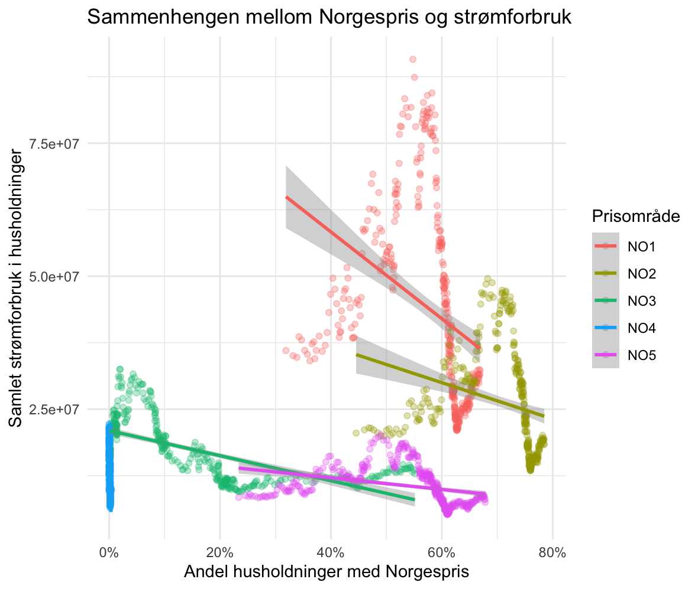

\
Abstract: 3-5 setninger

## 1. Introduksjon og objektiv

Strømprisene i Norge har hatt betydelige svingninger de siste årene, særlig mellom de ulike prisområdene. I 2021 nådde strømprisene historiske nivåer, spesielt i Sør-Norge (NO1 og NO2). Dette ble blant annet knyttet til høye kraftpriser i Europa og lavere magasinfylling enn normalt [@skaansar_kraftaret_2022]. Som følge av prisutviklingen innførte regjeringen strømstøtte i desember 2021 [@statsministerens_kontor_regjeringen_2021]. Prisvolatiliteten fortsatte i 2022 og bidro til at flere husholdninger reduserte strømforbruket sitt [@aanensen_statistikk_2026; @aanensen_lavere_2026; @kampevoll_prisen_2026]. 

Den 1. oktober 2025 innførte regjeringen Norgespris, en frivillig fastprisordning for strøm og fjernvarme. Ordningen ga husholdninger mulighet til å velge en fastpris på 40 øre/kWh ekskl. mva., med formål om å gi større forutsigbarhet i møte med volatile kraftpriser [@energidepartementet_norgespris_2025]. I oktober 2026 ble det besluttet at ordningen videreføres i 2027, med en justert pris på 45 øre/kWh ekskl. mva. [@energidepartementet_norgespris_2026]. 

Formålet med oppgaven er å undersøke sammenhengen mellom Norgespris, strømpriser og husholdningenes strømforbruk i Norge.

**Vi undersøker følgende problemstillinger:**

1.  Hvordan varierer strømforbruket mellom husholdninger med og uten Norgespris?

2.  Hvordan henger utviklingen i strømprisene sammen med husholdningenes adopsjon av Norgespris?

3.  I hvilken grad kan fyllingsgraden i norske vannmagasiner bidra til å forklare variasjoner i strømprisene?

Analysen bygger på data fra Nord Pool, Elhub og Norges vassdrags- og energidirektorat (NVE). Vi kombinerer deskriptiv statistikk og grafisk fremstilling med statistiske analyser og regresjonsmodeller for å undersøke utviklingstrekk og sammenhenger i datamaterialet.

## 2. Databehandling og implementering

Hele databehandlingsprosessen og de empiriske analysene er gjennomført i R. Analysen benytter sekundærdata fra tre sentrale aktører i det norske og nordiske kraftmarkedet:

1.  Elhub: Daglige data for aggregert strømforbruk (kWh), antall målepunkter og Norgespris-adopsjon, fordelt på prisområdene NO1–NO5 og forbruksgruppene husholdning og fritidsbolig [@sannes_norgespris_2026; @sannes_norgespris_2026-1; @stokke_hammer-dybvad_forbruk_2026].

2.  Norges vassdrags- og energidirektorat (NVE): Ukentlige data for fyllingsgraden i norske vannmagasiner [@norges_vassdrag_og_energidirektorat_magasinstatistikk_2026].

3.  Nord Pool: Daglige aggregerte spotpriser for perioden 2020–2026 og timepriser for perioden 1. oktober 2025–30. september 2026 [@nordpool_price_2026; @nordpool_prices_2026].

Rådataene er levert i CSV- og Excel-format og bearbeidet i R for å harmonisere tidsperioder, tidsoppløsning og geografisk inndeling. Datasettene er deretter kombinert til et felles datagrunnlag for analysene.

### **2.1 Nord Pool** 

Fra Nord Pool benytter vi daglige aggregerte spotpriser for de fem norske prisområdene (NO1–NO5) i perioden 2020–30. september 2026. I tillegg benyttes timebaserte spotpriser for perioden 1. oktober 2025–30. september 2026. **\<- sjekk dette Emily.**

Prisdataene ble lastet ned i separate Excel-filer og importert til R ved hjelp av `readxl`. Filene ble kombinert til samlede datasett, metadata og irrelevante observasjoner fjernet, og datoene standardisert og sortert kronologisk. Timeprisene ble tilsvarende kombinert ved hjelp av `map_dfr()`, hvor observasjonsdatoen ble hentet fra filnavnene.

Spotprisene er opprinnelig oppgitt i NOK/MWh og konvertert til NOK/kWh ved å dele på 1000. Dette sikrer sammenlignbare måleenheter i analysene av spotpriser, strømstøtte og Norgespris. \<- **Em, dobbelsjekk at vi trenger dette**

For timeprisene ble daglige oppsummeringsverdier (minimum, maksimum og gjennomsnitt) skilt fra de ordinære timeobservasjonene for å unngå at ulike tidsoppløsninger blandes i analysene.

### **2.2 Elhub – Norgespris og strømforbruk**

Dataene ble importert fra CSV-filer og omstrukturert fra bredt til langt format for å aggregere undergruppene til samlevariabler for husholdninger og fritidsboliger. På bakgrunn av disse ble det beregnet andeler av målepunkter med Norgespris og andeler av strømforbruket som dekkes av ordningen.

```{r}
#| eval: false
#| echo: true

library(tidyverse)
library(readr)

# 1. Finn og les inn målerdata fra Elhub
filer <- list.files(
  path = "data-kilde/maaler",
  pattern = "\\.(xls|xlsx|csv)\$",
  full.names = TRUE,
  ignore.case = TRUE
)

maalerdata <- read_csv2(filer) |> 
  rename(Date = `DATO`)

# 2. Omstrukturerer og aggregerer data for NO1 (eksempelkode)
# (Tilsvarende prosedyre utføres for NO2, NO3, NO4 og NO5)
maal_no1 <- maalerdata |> 
  filter(PRISOMRÅDE == "NO1") |> 
  pivot_wider(
    names_from = c(EAC_GRUPPE, FORBRUKSGRUPPE),
    values_from = c(ANTALL_NORGESPRIS, ANTALL, FORBRUK, FORBRUK_NORGESPRIS)
  ) |> 
  rowwise() |> 
  # Aggregerer antall målepunkter for husholdning og fritid
  mutate(sum_hus_NP  = sum(c_across(3:6))) |> 
  mutate(sum_fri_NP  = sum(c_across(7:10))) |> 
  mutate(sum_hus_tot = sum(c_across(11:14))) |> 
  mutate(sum_fri_tot = sum(c_across(15:18))) |> 
  # Aggregerer forbruk (kWh) for husholdning og fritid
  mutate(forbruk_hus    = sum(c_across(19:22))) |> 
  mutate(forbruk_fri    = sum(c_across(23:26))) |> 
  mutate(forbruk_hus_NP = sum(c_across(27:30))) |> 
  mutate(forbruk_fri_NP = sum(c_across(31:34))) |> 
  # Beregner adopsjons- og forbruksandeler
  mutate(prosent_hus_NP = sum_hus_NP / sum_hus_tot) |> 
  mutate(prosent_fri_NP = sum_fri_NP / sum_fri_tot) |> 
  mutate(prosent_forbruk_hus_NP = forbruk_hus_NP / forbruk_hus) |> 
  mutate(prosent_forbruk_fri_NP = forbruk_fri_NP / forbruk_fri)
```

Det er viktig å merke seg at antall målepunkter ikke nødvendigvis tilsvarer antall husholdninger, ettersom én husholdning kan disponere flere målepunkter. Resultatene må derfor tolkes som andeler av målepunkter, ikke andeler av husholdninger.

### **2.3 Konstruksjon av reell sluttpris og strømstøtte**

For å undersøke hvilke prissignaler husholdningene står overfor, beregnes en estimert sluttpris etter strømstøtte. Spotprisen alene gir ikke et fullstendig bilde av husholdningenes faktiske priskostnad, ettersom staten har gitt strømstøtte siden desember 2021.

Sluttprisen beregnes ved å trekke beregnet strømstøtte fra spotprisen. Beregningen tar hensyn til historiske endringer i støtteordningens dekningsgrad og innslagsterskel. Fra desember 2021 var støttesatsen først 55 %, før den ble økt til 80 % og senere 90 %. Innslagsterskelen ble gradvis justert fra 70 øre/kWh til 77 øre/kWh i 2026.

Videre konstrueres Norgespris som en referansepris på 40 øre/kWh ekskl. mva. (50 øre inkl. mva.) fra 1. oktober 2025.

```{r}
#| eval: false
#| echo: true

# Forutsetter 'strompriser' (fra 2.2) eller 'dognstatistikk_w' (fra 2.3)
stotteutregner <- function(cc) {  
  cc |> 
    mutate(
      across(
        .cols = starts_with("NO"),
        .fns = ~ case_when(
          Date < as.Date("2021-12-01") ~ 0,
          Date < as.Date("2022-01-01") & .x >= 0.70 ~ (.x - 0.70) * 0.55,
          Date < as.Date("2022-09-01") & .x >= 0.70 ~ (.x - 0.70) * 0.80,
          Date < as.Date("2024-01-01") & .x >= 0.70 ~ (.x - 0.70) * 0.90,
          Date < as.Date("2025-01-01") & .x >= 0.73 ~ (.x - 0.73) * 0.90,
          Date < as.Date("2026-01-01") & .x >= 0.75 ~ (.x - 0.75) * 0.90,
          Date >= as.Date("2026-01-01") & .x >= 0.77 ~ (.x - 0.77) * 0.90,
          TRUE ~ 0
        ), 
        .names = "stotte_{.col}"
      )
    ) |> 
    # Beregner sluttpris per prisområde
    mutate(
      across(
        .cols = starts_with("NO"),
        .fns = ~ .x - pick(paste0("stotte_", cur_column()))[[1]],
        .names = "slutt_{.col}"
      )
    ) |> 
    # Legger til Norgespris
    mutate(
      Norgespris_uMVA = if_else(Date >= as.Date("2025-10-01"), 0.40, 0),
      Norgespris_mMVA = if_else(Date >= as.Date("2025-10-01"), 0.50, 0)
    )
}
  return(cc_ny)
```

### 2.4 NVE – fyllingsgrad i vannmagasiner

For å undersøke sammenhengen mellom magasinfylling og strømpriser benytter vi ukentlige data fra NVE for perioden 2020–2026, fordelt på de fem norske prisområdene.

Excel-filene ble importert og bearbeidet i R. Dataene ble omstrukturert fra bredt til langt format, slik at hver observasjon representerer fyllingsgraden for et gitt prisområde og en bestemt uke. Datasettene ble deretter kombinert til et samlet datasett basert på år, uke og prisområde.

Fyllingsgraden gir informasjon om tilgjengelig vannkraftressurs og kan påvirke produsentenes vannverdier og forventninger om fremtidig krafttilgang. Samtidig påvirkes spotprisene av andre faktorer, blant annet temperatur, etterspørsel, overføringskapasitet og europeiske kraftpriser. Dette gjør det relevant å undersøke fyllingsgradens statistiske sammenheng med spotprisene, kontrollert for sesongvariasjoner og regionale forskjeller.

## 3. Metode

Analysen kombinerer ordinær lineær regresjon (OLS) med faste effekter og regularisert regresjon (LASSO) for å undersøke statistiske sammenhenger og modellens prediksjonsevne. Databehandling og modellering er gjennomført i R, med Tidyverse og Tidymodels som sentrale rammeverk [@wickham_r_2016; @kuhn_tidy_2023].

Valget av estimeringsmetoder bygger på skillet mellom økonomisk parameterestimering og prediksjon [@athey_machine_2019; @hammersmark_econ3170_2026].

``` r
```{r}
#| include: false 

# ============================================================
# 0. PAKKER
# ============================================================

library(readr)
library(readxl)
library(tidyverse)
library(lubridate)
library(dplyr)
library(purrr)
library(glmnet)
library(tidymodels)
library(broom)


# ============================================================
# 1. ELHUB - IMPORT OG BEARBEIDING AV MÅLERDATA
# ============================================================

filer_maaler <- list.files(
  path = "data-kilde/maaler",
  pattern = "\\.(xls|xlsx|csv)$",
  full.names = TRUE,
  ignore.case = TRUE
)

maalerdata <- map_dfr(filer_maaler, function(fil) {
  
  if (grepl("\\.csv$", fil, ignore.case = TRUE)) {
    read_csv2(fil, show_col_types = FALSE)
  } else {
    read_excel(fil)
  }
  
}) |>
  rename(Date = DATO)


# Funksjon for å aggregere målerdata per prisområde

beregn_prisområde <- function(data, omrade_navn) {
  
  data |>
    filter(PRISOMRÅDE == omrade_navn) |>
    pivot_wider(
      names_from = c(EAC_GRUPPE, FORBRUKSGRUPPE),
      values_from = c(
        ANTALL_NORGESPRIS,
        ANTALL,
        FORBRUK,
        FORBRUK_NORGESPRIS
      ),
      values_fill = 0
    ) |>
    rowwise() |>
    mutate(
      sum_hus_NP = sum(
        c_across(starts_with("ANTALL_NORGESPRIS_HUSHOLDNING")),
        na.rm = TRUE
      ),
      sum_fri_NP = sum(
        c_across(starts_with("ANTALL_NORGESPRIS_FRITID")),
        na.rm = TRUE
      ),
      sum_hus_tot = sum(
        c_across(starts_with("ANTALL_HUSHOLDNING")),
        na.rm = TRUE
      ),
      sum_fri_tot = sum(
        c_across(starts_with("ANTALL_FRITID")),
        na.rm = TRUE
      ),
      forbruk_hus = sum(
        c_across(starts_with("FORBRUK_HUSHOLDNING")),
        na.rm = TRUE
      ),
      forbruk_fri = sum(
        c_across(starts_with("FORBRUK_FRITID")),
        na.rm = TRUE
      ),
      forbruk_hus_NP = sum(
        c_across(starts_with("FORBRUK_NORGESPRIS_HUSHOLDNING")),
        na.rm = TRUE
      ),
      forbruk_fri_NP = sum(
        c_across(starts_with("FORBRUK_NORGESPRIS_FRITID")),
        na.rm = TRUE
      )
    ) |>
    ungroup() |>
    mutate(
      prosent_hus_NP = sum_hus_NP / sum_hus_tot,
      prosent_fri_NP = sum_fri_NP / sum_fri_tot,
      prosent_forbruk_hus_NP = forbruk_hus_NP / forbruk_hus,
      prosent_forbruk_fri_NP = forbruk_fri_NP / forbruk_fri
    )
}


# Samler alle fem prisområdene

omraader <- c("NO1", "NO2", "NO3", "NO4", "NO5")

maal_samlet <- map_dfr(
  omraader,
  ~ beregn_prisområde(maalerdata, .x)
) |>
  as_tibble()


# ============================================================
# 2. NORD POOL - TIMEPRISER
# ============================================================

mappe <- "data-kilde/Nordpool_2025_2026"

filer_nordpool <- list.files(
  path = mappe,
  pattern = "\\.xlsx$",
  full.names = TRUE,
  ignore.case = TRUE
)

length(filer_nordpool)


# Leser og kombinerer alle timeprisfilene

priser_per_time <- map_dfr(filer_nordpool, function(fil) {
  
  dato <- str_extract(
    basename(fil),
    "\\d{4}-\\d{2}-\\d{2}"
  )
  
  read_excel(fil, skip = 4) |>
    mutate(Date = as.Date(dato)) |>
    select(-2) |>
    rename(hour = `Delivery period (CET)`) |>
    relocate(Date, hour) |>
    mutate(
      across(starts_with("NO"), ~ .x / 1000)
    )
})


# Skiller ut daglige oppsummeringsverdier

dognstatistikk <- priser_per_time |>
  filter(hour %in% c("Min:", "Max:", "Average:")) |>
  rename(Statistic = hour) |>
  pivot_longer(
    cols = starts_with("NO"),
    names_to = "Price_area",
    values_to = "Price"
  )


# Lager døgnstatistikk i bredt format

dognstatistikk_w <- priser_per_time |>
  filter(hour %in% c("Min:", "Max:", "Average:")) |>
  rename(Statistic = hour) |>
  pivot_wider(
    names_from = Statistic,
    values_from = starts_with("NO")
  )


# Fjerner Min, Max og Average fra timeprisdataene

timepriser <- priser_per_time |>
  filter(!hour %in% c("Min:", "Max:", "Average:"))


# ============================================================
# 3. STRØMSTØTTE OG NORGESPRIS
# ============================================================

stotteutregner <- function(cc) {
  
  cc_ny <- cc |>
    mutate(
      across(
        .cols = starts_with("NO"),
        .fns = ~ case_when(
          
          # Før strømstøtten
          Date < as.Date("2021-12-01") ~ 0,
          
          # Desember 2021: 55 prosent
          Date < as.Date("2022-01-01") &
            Date >= as.Date("2021-12-01") &
            .x >= 0.70 ~ (.x - 0.70) * 0.55,
          
          # Januar-mars 2022: 80 prosent
          Date < as.Date("2022-04-01") &
            Date >= as.Date("2022-01-01") &
            .x >= 0.70 ~ (.x - 0.70) * 0.80,
          
          # April-august 2022: 80 prosent
          Date < as.Date("2022-09-01") &
            Date >= as.Date("2022-04-01") &
            .x >= 0.70 ~ (.x - 0.70) * 0.80,
          
          # September-desember 2022: 90 prosent
          Date < as.Date("2023-01-01") &
            Date >= as.Date("2022-09-01") &
            .x >= 0.70 ~ (.x - 0.70) * 0.90,
          
          # Januar-september 2023
          Date < as.Date("2023-10-01") &
            Date >= as.Date("2023-01-01") &
            .x >= 0.70 ~ (.x - 0.70) * 0.90,
          
          # Oktober-desember 2023
          Date < as.Date("2024-01-01") &
            Date >= as.Date("2023-10-01") &
            .x >= 0.70 ~ (.x - 0.70) * 0.90,
          
          # 2024
          Date < as.Date("2025-01-01") &
            Date >= as.Date("2024-01-01") &
            .x >= 0.73 ~ (.x - 0.73) * 0.90,
          
          # 2025
          Date < as.Date("2026-01-01") &
            Date >= as.Date("2025-01-01") &
            .x >= 0.75 ~ (.x - 0.75) * 0.90,
          
          # 2026
          Date >= as.Date("2026-01-01") &
            .x >= 0.77 ~ (.x - 0.77) * 0.90,
          
          TRUE ~ 0
        ),
        .names = "stotte_{.col}"
      )
    ) |>
    
    # Beregner sluttpris etter strømstøtte
    mutate(
      across(
        .cols = starts_with("NO"),
        .fns = ~ .x - pick(
          paste0("stotte_", cur_column())
        )[[1]],
        .names = "slutt_{.col}"
      )
    ) |>
    
    # Konstruerer Norgespris
    mutate(
      Norgespris_uMVA = case_when(
        Date < as.Date("2025-10-01") ~ 0,
        TRUE ~ 0.4
      ),
      Norgespris_mMVA = case_when(
        Date < as.Date("2025-10-01") ~ 0,
        TRUE ~ 0.5
      )
    )
  
  return(cc_ny)
}


# ============================================================
# 4. NVE - FYLLINGSGRAD I VANNMAGASINER
# ============================================================

filer_fylling <- list.files(
  "data-kilde/fylling",
  pattern = "\\.(xls|xlsx|csv)$",
  full.names = TRUE,
  ignore.case = TRUE
)


# Leser og formatterer filene

data_liste <- lapply(filer_fylling, function(fil) {
  
  navn <- basename(fil) |>
    str_remove("\\, 2020, 2021, 2022, 2023, 2024, 2025, 2026.xlsx")
  
  if (grepl("\\.csv$", fil, ignore.case = TRUE)) {
    data <- read_csv2(fil, skip = 2, show_col_types = FALSE)
  } else {
    data <- read_excel(fil, skip = 2)
  }
  
  data |>
    select(1, 5:11) |>
    rename_with(
      ~ str_extract(.x, "\\d{4}"),
      .cols = -Uke
    ) |>
    arrange(Uke) |>
    pivot_longer(
      cols = -Uke,
      names_to = "år",
      values_to = navn
    ) |>
    mutate(år = as.numeric(år)) |>
    arrange(år, Uke)
})


# Kombinerer data fra alle prisområdene

fyll_2020_2026 <- data_liste |>
  reduce(inner_join, by = c("Uke", "år")) |>
  drop_na() |>
  relocate(år, Uke)


# ============================================================
# 5. SAMMENSTILLING AV ALLE DATA
# ============================================================

# Beregner strømstøtte på døgnstatistikken

dogn_stotte <- stotteutregner(dognstatistikk_w)


# Gjør prisdata om til langt format

priser_long <- dogn_stotte |>
  rename_with(
    ~ paste0("spotpris_", .x),
    .cols = matches("^NO\\d+ \\(NOK\\)")
  ) |>
  pivot_longer(
    cols = matches("^(spotpris_|stotte_|slutt_)"),
    names_to = c("PRISTYPE", "PRISOMRÅDE", "MÅLING"),
    names_pattern = "^(spotpris|stotte|slutt)_(NO\\d) \\(NOK\\)_(Min:|Max:|Average:)$",
    values_to = "VERDI"
  ) |>
  pivot_wider(
    names_from = c(PRISTYPE, MÅLING),
    values_from = VERDI,
    names_glue = "{PRISTYPE}_{MÅLING}"
  )


# Gjør magasinfylling om til langt format

fyll_long <- fyll_2020_2026 |>
  pivot_longer(
    cols = matches("NO\\d+$"),
    names_to = "PRISOMRÅDE",
    names_prefix = "Fyllingsgrad (%) ",
    values_to = "fyllingsgrad"
  )


# Kombinerer prisdata, målerdata og magasinfylling

all_data_samlet <- priser_long |>
  inner_join(
    maal_samlet,
    by = c("Date", "PRISOMRÅDE")
  ) |>
  mutate(
    år = year(Date),
    Uke = isoweek(Date)
  ) |>
  left_join(
    fyll_long,
    by = c("år", "Uke", "PRISOMRÅDE")
  ) |>
  rename(
    slutt_Average = `slutt_Average:`
  )


# ============================================================
# 6. KONTROLL AV DET FERDIGE DATASETTET
# ============================================================

# Antall observasjoner og variabler
dim(all_data_samlet)

# Kontroller kolonnenavn
names(all_data_samlet)

# Kontroller datoer
range(all_data_samlet$Date, na.rm = TRUE)

# Kontroller antall observasjoner per prisområde
count(all_data_samlet, PRISOMRÅDE)

# Kontroller manglende verdier i sentrale variabler
all_data_samlet |>
  summarise(
    mangler_forbruk = sum(is.na(forbruk_hus)),
    mangler_norgespris = sum(is.na(prosent_hus_NP)),
    mangler_spotpris = sum(is.na(slutt_Average)),
    mangler_fyllingsgrad = sum(is.na(fyllingsgrad))
  )

# ============================================================
# FERDIG: all_data_samlet ER KLART TIL ANALYSENE
# ============================================================
```

### **3.1 Empirisk datastruktur og paneldatamodellering**

Analysen bygger på det sammensatte datasettet all_data_samlet, som inneholder daglige observasjoner for de fem norske elspotområdene (NO1–NO5). Datasettet kombinerer dermed tidsvariasjon med geografiske forskjeller.For å kontrollere for regionale forskjeller og sesongvariasjoner benyttes faste effekter. Den generelle modellstrukturen er:

$y_{it} = \beta_0 + \mathbf{\beta} \mathbf{X}_{it} + \alpha_i + \delta_m + \varepsilon_{it}$

Her representerer $y_{it}$ den avhengige variabelen, mens $X_{it}$ er forklaringsvariablene. Områdefaste effekter $(\alpha_i)$ kontrollerer for tidskonstante forskjeller mellom prisområdene, mens månedsfaste effekter $(\delta_m)$ fanger opp sesongvariasjoner, blant annet knyttet til temperatur og oppvarmingsbehov.

### 3.2 Spesifikasjon av estimeringsmodellene (OLS)

Det estimeres tre OLS-modeller for å undersøke oppgavens problemstillinger.

#### Problemstilling 1: Norgespris og strømforbruk

For å undersøke hvordan husholdningenes strømforbruk varierer med Norgespris-adopsjon, spesifiseres følgende modell:

$\text{forbruk\_hus}_{it} = \beta_0 + \beta_1 \text{prosent\_hus\_NP}_{it} + \beta_2 \text{slutt\_Average}_{it} + \alpha_i + \delta_m + \varepsilon_{it}$

hvor $\text{forbruk\_hus}_{it}$ er gjennomsnittlig dagsforbruk per målepunkt (kWh), $\text{prosent\_hus\_NP}_{it}$ er andelen målepunkter med Norgespris og $\text{slutt\_Average}_{it}$ gjennomsnittlig strømpris etter strømstøtte (NOK/kWh).

Ettersom Norgespris er en frivillig ordning, kan husholdningenes avtalevalg være påvirket av forventet strømforbruk og prisfølsomhet. Dette gir risiko for seleksjonsskjevhet. Koeffisienten for Norgespris-adopsjon tolkes derfor som en statistisk sammenheng, ikke en kausal effekt.

```{r}
#| eval: false
#| echo: true

# Estimering av OLS-modell med faste effekter for område og måned
modell_p1 <- lm(
  forbruk_hus ~ prosent_hus_NP + slutt_Average + 
    factor(PRISOMRÅDE) + factor(month(Date)),
  data = all_data_samlet
)

```

#### **Problemstilling 2: Prisdynamikk og adopsjon av Norgespris**

For å undersøke sammenhengen mellom strømpriser, magasinfylling og husholdningenes adopsjon av Norgespris estimeres følgende modell:

$\text{prosent\_hus\_NP}_{it} = \beta_0 + \beta_1 \text{slutt\_Average}_{it} + \beta_2 \text{fyllingsgrad}_{it} + \alpha_i + \gamma t + \varepsilon_{it}$

Her representerer `slutt_Average` gjennomsnittlig strømpris etter støtte, $\text{fyllingsgrad}_{it}$ fanger opp den ukentlige magasinfyllingen fra NVE, og $t$ en lineær tidstrend (`as.numeric(Date)`). Tidstrenden inkluderes for å kontrollere for den generelle utviklingen i Norgespris-adopsjonen over perioden.

#### **Problemstilling 3: Magasinfylling og spotpris**

For å undersøke i hvilken grad magasinfyllingen kan bidra til å forklare variasjoner i spotprisene, estimeres følgende modell:

$\text{spotpris}_{it} = \beta_0 + \beta_1 \text{fyllingsgrad}_{it} + \alpha_i + \delta_{\text{uke}} + \varepsilon_{it}$

hvor $\delta_{\text{uke}}$ fanger opp historiske sesongmønstre i magasinfylling og etterspørsel.

Her representerer `spotpris` spotprisen i det aktuelle prisområdet, mens `fyllingsgrad` måler den ukentlige magasinfyllingen. Områdefaste effekter kontrollerer for regionale forskjeller, mens ukefaste effekter fanger opp sesongmessige variasjoner i blant annet magasinfylling og etterspørsel.

### **3.3 Regularisert regresjon og LASSO-modellering**

I tillegg til OLS benyttes LASSO-regresjon (Least Absolute Shrinkage and Selection Operator) som en alternativ estimeringsmetode. LASSO kombinerer lineær regresjon med en \\(L_1\\)-straff som begrenser størrelsen på koeffisientene og kan sette mindre relevante koeffisienter lik null. Metoden brukes dermed til variabelseleksjon og kan redusere risikoen for overtilpasning [@tibshirani_regression_1996; @hastie_elements_2009; @fonti_feature_2017; @gentzkow_text_2019].

LASSO-modellen estimeres ved å minimere:

$\hat{\beta}_{\text{lasso}} = \arg\min_{\beta} \left( \sum_{i=1}^N \left( y_i - \beta_0 - \sum_{j=1}^p x_{ij}\beta_j \right)^2 + \lambda \sum_{j=1}^p |\beta_j| \right)$

Straffeparameteren $\lambda$ bestemmer graden av regularisering. En høyere verdi gir sterkere krymping av koeffisientene, mens en lavere verdi gjør modellen mer lik ordinær lineær regresjon.

For å evaluere prediksjonsevnen deles datamaterialet i et treningssett (80 %) og et testsett (20 %). Straffeparameteren velges gjennom 10-fold kryssvalidering på treningsdataene, med RMSE og $R^2$ som evalueringsmål. Den endelige modellen evalueres deretter på testsettet.

**Metodisk merknad om valg av** $\lambda$**:** Kryssvalideringen valgte en svært lav verdi for $\lambda$. Dette innebærer svak regularisering, men er ikke i seg selv et tegn på overtilpasning. Modellens prediksjonsevne må vurderes ut fra resultatene på testsettet og sammenlignes med OLS \[@hastie_elements_2009\].

Utdrag fra koden (inneholder kun arbeidskommentarer for å spare plass og forklare arbeidsflyt):

```{r}
#| eval: false
#| echo: true

# Deler data i trening (80 %) og test (20 %)

# Oppretter Recipe

# Spesifiserer LASSO-modellen

# velger hvor mange deler den skal ha  

set.seed(3170)

# tuner 

# finner beste lambda 

#ser at lambda er veldig veldig lav, redd dette lager en overfitted modell 

# tester modellen på testdaten 

```

## 4. Resultat og evaluering

I dette kapittelet presenteres resultatene fra de empiriske analysene. Resultatene er strukturert etter oppgavens tre problemstillinger. Først undersøkes sammenhengen mellom Norgespris-adopsjon og husholdningenes samlede strømforbruk. Deretter analyseres sammenhengen mellom strømpriser, magasinfylling og adopsjon av Norgespris. Til slutt undersøkes sammenhengen mellom magasinfylling og spotpriser i de norske prisområdene.

### 4.1 Historisk utvikling i strømpriser

Figur 4.1 viser utviklingen i gjennomsnittlige døgnpriser i de fem norske prisområdene fra 2020 til 2026. Figuren illustrerer både variasjoner i strømprisene over tid og geografiske forskjeller mellom prisområdene. Prisområdene har ikke hatt identisk prisutvikling, noe som viser betydningen av å kontrollere for geografiske forskjeller i de videre regresjonsanalysene.

{fig-align="left"}

#### 4.2 Problemstilling 1: Norgespris-adopsjon og husholdningenes strømforbruk

For å undersøke sammenhengen mellom Norgespris-adopsjon og husholdningenes strømforbruk estimeres en OLS-modell med samlet husholdningsforbruk per prisområde som avhengig variabel. Modellen inkluderer andelen husholdningsmålepunkter med Norgespris, nettopris, områdefaste effekter og månedsfaste effekter.

Figur 4.2 viser den deskriptive sammenhengen mellom andelen husholdningsmålepunkter med Norgespris og samlet husholdningsforbruk, fordelt på prisområde. Trendlinjene illustrerer hvordan sammenhengen varierer mellom områdene.



```{{r}}
#| echo: false
#| warning: false
#| message: false

library(dplyr)
library(broom)
library(knitr)

# OLS
ols_tabell <- tidy(modell_p1) |>
  filter(term %in% c("prosent_hus_NP", "slutt_Average")) |>
  mutate(
    Variabel = recode(
      term,
      "prosent_hus_NP" = "Andel husholdninger med Norgespris",
      "slutt_Average" = "Spotpris"
    ),
    OLS = sprintf("%.0f (%.0f)", estimate, std.error)
  ) |>
  select(Variabel, OLS)

# LASSO
lasso_tabell <- koeffisienter_lasso |>
  filter(term %in% c("prosent_hus_NP", "slutt_Average")) |>
  mutate(
    Variabel = recode(
      term,
      "prosent_hus_NP" = "Andel husholdninger med Norgespris",
      "slutt_Average" = "Spotpris"
    ),
    LASSO = round(estimate, 0)
  ) |>
  select(Variabel, LASSO)

# Lager tabellen
tabell_41 <- left_join(ols_tabell, lasso_tabell, by = "Variabel")

knitr::kable(
  tabell_41,
  format = "html",
  caption = "Tabell 4.1. Regresjonsresultater for modell P1",
  align = "lrr"
)

**\[MANGLER: Sammenlignbare prediksjonsmål for OLS og LASSO på samme testsett. OLS-modellen er foreløpig ikke evaluert på LASSO-modellens testsett.\]**

*Når regresjonsresultatene foreligger, drøftes sammenhengen mellom adopsjonsandel og aggregert forbruk, samt hvordan resultatene påvirkes av nettopris og kontrollvariablene. Siden analysen bygger på aggregerte data for hvert prisområde, kan resultatene ikke brukes til å fastslå hvordan forbruket varierer mellom enkeltstående husholdninger med og uten Norgespris.*

### 4.3 Problemstilling 2: Strømpriser og adopsjon av Norgespris

For å undersøke sammenhengen mellom strømpriser og husholdningenes adopsjon av Norgespris estimeres tre OLS-modeller med gradvis flere forklaringsvariabler. Modell 2A inkluderer nettopris som eneste forklaringsvariabel. Modell 2B inkluderer i tillegg magasinfylling og områdefaste effekter, mens modell 2C også kontrollerer for en lineær tidstrend.

**\[Sett inn tabell 4.2: Regresjonsresultater for modell 2A, 2B og 2C.\]**

Nettoprisen har en positiv sammenheng med adopsjonsandelen i alle tre modellspesifikasjonene. Koeffisienten reduseres imidlertid fra 0,772 i modell 2A til 0,058 i modell 2C. Dette viser at sammenhengen mellom nettopris og adopsjon blir betydelig svakere når det kontrolleres for magasinfylling, geografiske forskjeller og generell tidsutvikling.

Magasinfyllingen har en negativ sammenheng med adopsjonsandelen i de utvidede modellene. Dette kan være forenlig med at høy magasinfylling reduserer insentivet til å velge Norgespris, mens lav magasinfylling kan øke verdien av prisforutsigbarhet.

Den positive tidstrenden i modell 2C viser at adopsjonsandelen øker over tid, kontrollert for de øvrige variablene. Tidstrenden fanger imidlertid opp den generelle utviklingen og kan ikke isolert knyttes til økt kjennskap til ordningen.

### 4.4 Problemstilling 3: Magasinfylling og spotprisdannelse

Den tredje problemstillingen undersøker i hvilken grad fyllingsgraden i norske vannmagasiner kan bidra til å forklare variasjoner i spotprisene. Analysen tar utgangspunkt i variasjoner i magasinfylling og spotpriser på tvers av de fem norske prisområdene.

**\[MANGLER: Regresjonstabell med koeffisienten for magasinfylling, standardfeil, signifikans, R² og antall observasjoner.\]**

**\[MANGLER: Figur som viser sammenhengen mellom magasinfylling og spotpris, fordelt på prisområde.\]**

Resultatene vil brukes til å vurdere om det er en systematisk sammenheng mellom ressurstilgangen i vannkraftsystemet og spotprisene. Eventuelle geografiske og sesongmessige forskjeller drøftes med utgangspunkt i modellresultatene.

## 5. Konklusjon

## 6. Bruk av KI

## 7. Kilder

## 8. Vedlegg
