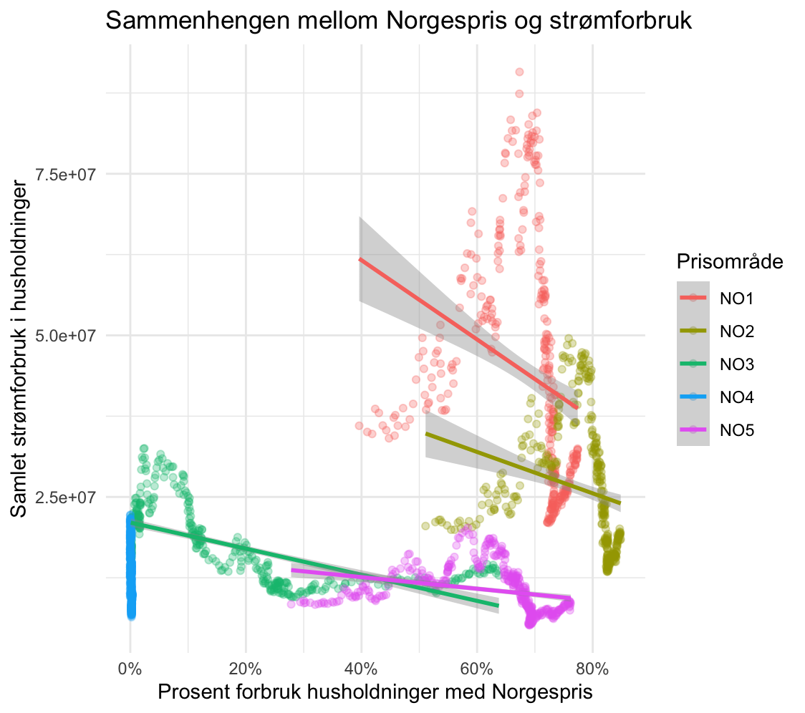
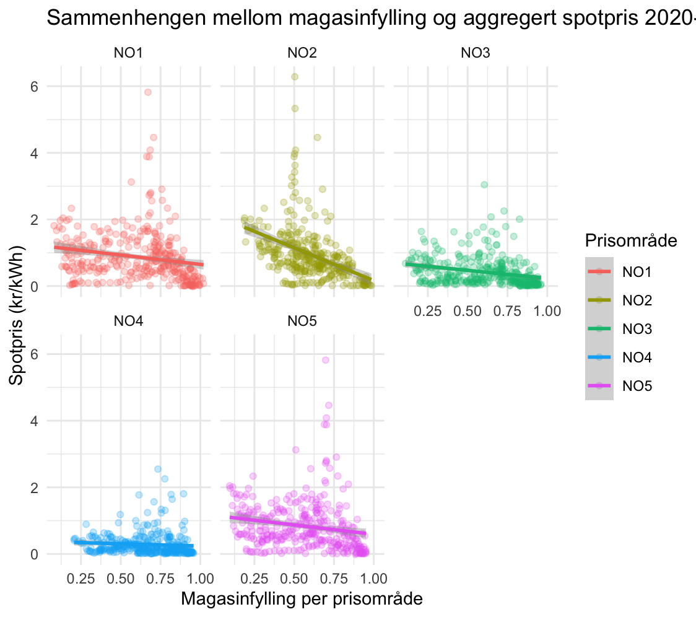

```{r}
#| include: false

# Pakker for databehandling
library(tidyverse)
library(readr)
library(readxl)
library(lubridate)
library(purrr)
library(dplyr)
library(janitor)

# Pakker for regresjon og statistisk analyse
library(glmnet)
library(tidymodels)
library(broom)

# Pakker for tabeller
library(knitr)
```

## Abstract

Denne oppgaven undersøker sammenhengen mellom Norgespris, strømpriser og husholdningenes strømforbruk i Norge. Med utgangspunkt i data fra Nord Pool, Elhub og NVE for perioden 2020–2026 analyseres forskjeller i strømforbruk mellom husholdninger med ulik Norgespris-adopsjon, sammenhengen mellom strømpriser og nye signeringer av Norgespris, samt forholdet mellom magasinfylling og spotpriser. Analysen kombinerer deskriptiv statistikk med OLS- og LASSO-regresjon for å undersøke statistiske sammenhenger og modellens prediksjonsevne. Resultatene viser en negativ sammenheng mellom magasinfylling og spotpriser, mens OLS og LASSO har tilnærmet lik prediksjonsevne i analysen av husholdningenes strømforbruk. Tilsvarende OLS og LASSO ingen klare sammenhenger mellom variabler som kan brukes til å predikere husholdningenes lyst til å inngå Norgesprisavtaler.

## 1. Introduksjon og objektiv

Strømprisene i Norge har hatt betydelige svingninger de siste årene, særlig mellom de ulike prisområdene. I 2021 nådde strømprisene historiske nivåer, spesielt i Sør-Norge (NO1 og NO2). Dette ble blant annet knyttet til høye kraftpriser i Europa og lavere magasinfylling enn normalt [@skaansar_kraftaret_2022]. Som følge av prisutviklingen innførte regjeringen strømstøtte i desember 2021 [@statsministerens_kontor_regjeringen_2021].

Den 1. oktober 2025 innførte regjeringen Norgespris, en frivillig fastprisordning for strøm og fjernvarme. Ordningen ga husholdninger mulighet til å velge en fastpris på 40 øre/kWh ekskl. mva. [@energidepartementet_norgespris_2025]. I oktober 2026 ble det besluttet at ordningen videreføres i 2027, med en justert pris på 45 øre/kWh ekskl. mva. [@energidepartementet_norgespris_2026].

Formålet med oppgaven er å undersøke sammenhengen mellom Norgespris, strømpriser og husholdningenes strømforbruk i Norge.

**Vi undersøker følgende problemstillinger:**

1.  Hvordan varierer strømforbruket mellom husholdninger med og uten Norgespris?

2.  Hvordan henger utviklingen i strømprisene sammen med husholdningenes adopsjon av Norgespris?

3.  I hvilken grad kan fyllingsgraden i norske vannmagasiner bidra til å forklare variasjoner i strømprisene?

Analysen bygger på data fra Nord Pool, Elhub og Norges vassdrags- og energidirektorat (NVE). Vi kombinerer deskriptiv statistikk og grafisk fremstilling med statistiske analyser og regresjonsmodeller for å undersøke utviklingstrekk og sammenhenger i datamaterialet.

## 2. Databehandling og implementering

Hele databehandlingsprosessen og de empiriske analysene er gjennomført i R med følgende sekundærdata:

1.  Elhub: Daglige data for aggregert strømforbruk (kWh), antall målepunkter og Norgespris-adopsjon, fordelt på prisområdene NO1–NO5 og forbruksgruppene husholdning og fritidsbolig [@sannes_norgespris_2026; @sannes_norgespris_2026-1; @stokke_hammer-dybvad_forbruk_2026].

2.  Norges vassdrags- og energidirektorat (NVE): Ukentlige data for fyllingsgraden i norske vannmagasiner [@norges_vassdrag_og_energidirektorat_magasinstatistikk_2026].

3.  Nord Pool: Daglige aggregerte spotpriser for perioden 2020–2026 og timepriser for perioden 1. oktober 2025–30. september 2026 [@nordpool_price_2026; @nordpool_prices_2026].

Rådataene er hentet i CSV- og Excel-format, bearbeidet individuelt også kombinert til et felles datagrunnlag for analysene.

### 2.1 Nord Pool - strompriser_Nordpool.R

Fra Nord Pool benytter vi daglige aggregerte spotpriser for de fem norske prisområdene (NO1–NO5) i perioden 2020–29. september 2026. I tillegg benyttes timebaserte spotpriser for perioden 1. oktober 2025–30. september 2026.

Prisdataene ble lastet ned i separate Excel-filer og importert til R ved hjelp av `readxl`. Filene ble kombinert til samlede datasett. Metadata og "NA" observasjoner fjernet. Datoene ble standardisert og sortert kronologisk. Timeprisene ble tilsvarende kombinert. For timeprisene ble daglige oppsummeringsverdier (minimum, maksimum og gjennomsnitt) skilt fra de ordinære timeobservasjonene for å unngå at ulike tidsoppløsninger blandes i analysene.

Prisene i begge datasettene er opprinnelig oppgitt i NOK/MWh. Vi har konvertert til NOK/kWh ved å dele på 1000. Dette gir sammenlignbare måleenheter på tvers av data, særlig opp mot at strømstøtte og norgespris er definert i NOK/kWh. Variabelnavnene standardisert med janitor

### 2.2. Elhub – Norgespris og strømforbruk - funksjon_for_maaler.R

Dataene ble importert fra CSV-filer og omstrukturert fra bredt til langt format for å aggregere undergruppene til samlevariabler for husholdninger og fritidsboliger. På bakgrunn av disse ble det beregnet andeler av målepunkter med Norgespris og andeler av strømforbruket som dekkes av ordningen. variabelnavnene standardisert med janitor.

Det er viktig å merke seg at antall målepunkter ikke nødvendigvis tilsvarer antall husholdninger, ettersom én husholdning kan disponere flere målepunkter.

### 2.3. Konstruksjon av reell sluttpris og strømstøtte - stottefunk.R

For å undersøke hvilke prissignaler husholdningene står overfor, beregnes en estimert sluttpris etter strømstøtte. Spotprisen alene gir ikke et fullstendig bilde av husholdningenes faktiske priskostnad, ettersom staten har gitt strømstøtte siden desember 2021. [@regjeringen_stromstotte]

Sluttprisen beregnes ved å trekke beregnet strømstøtte fra spotprisen. Beregningen tar hensyn til historiske endringer i støtteordningens dekningsgrad og innslagsterskel. Fra desember 2021 var støttesatsen først 55 %, før den ble økt til 80 % og senere 90 %. Innslagsterskelen ble gradvis justert fra 70 øre/kWh til 77 øre/kWh i 2026.

Videre konstrueres Norgespris som en referansepris på 40 øre/kWh ekskl. mva. (50 øre inkl. mva.) fra 1. oktober 2025. Variabelnavnene standardisert med janitor

### 2.4. NVE – fyllingsgrad i vannmagasiner - fylling.R

For å undersøke sammenhengen mellom magasinfylling og strømpriser benyttes ukentlige data fra Norges vassdrags- og energidirektorat (NVE) for perioden 2020–2026, fordelt på de fem norske prisområdene. Magasinfyllingen sier noe om tilgangen på vannkraft og kan påvirke kraftprodusentenes vurderinger av vannverdien og forventninger til fremtidig krafttilgang.

Excel-filene ble lest inn og bearbeidet i R, der dataene fra de ulike årene ble slått sammen og organisert etter prisområde og uke. Årstall og ISO-ukenummer ble konvertert til datoer med mandag som referansedag ved hjelp av pakken ISOweek. Manglende observasjoner ble fjernet, og variabelnavnene standardisert med janitor.

## 3. Metode

Analysen benytter ordinær minste kvadraters metode (OLS) og regularisert regresjon (LASSO) for å undersøke statistiske sammenhenger og prediksjonsevne. OLS benyttes som hovedmetode for å estimere sammenhenger mellom variablene, mens LASSO brukes som en supplerende metode for variabelseleksjon og prediksjon i problemstilling 1 og 2. I problemstilling 1 og 2 sammenlignes også prediksjonsevnen til OLS og LASSO på felles testsett. Databehandling og modellering er gjennomført i R, med Tidyverse og Tidymodels som sentrale rammeverk [@wickham_r_2016; @kuhn_tidy_2023].

```{r}
#| include: false

# 1. NORD POOL - HISTORISKE AGGREGERTE PRISER 2020-2026

# Prisene er oppgitt i NOK/MWh

filer_nordpool <- list.files(
  here::here("data-kilde", "Nordpool"),
  pattern = "^[^~].*\\.xlsx$",
  full.names = TRUE
)

# Leser inn filene og hopper over de fire første radene
data_liste_nordpool <- lapply(filer_nordpool, function(fil) {
  read_excel(fil, skip = 4)
})

strompriser <- bind_rows(data_liste_nordpool) |>
  select(-2) |>
  mutate(
    `Delivery Date (CET)` = as.Date(`Delivery Date (CET)`)
  ) |>
  arrange(`Delivery Date (CET)`) |>
  mutate(
    across(starts_with("NO"), ~ .x / 1000)
  )

# Kontrollerer datoperioden
strompriser |>
  summarise(
    fra = min(`Delivery Date (CET)`, na.rm = TRUE),
    til = max(`Delivery Date (CET)`, na.rm = TRUE),
    antall_datoer = n_distinct(`Delivery Date (CET)`)
  )

# Omformer historiske spotpriser til langt format
spotpris_historisk_long <- strompriser |>
  rename(date = `Delivery Date (CET)`) |>
  pivot_longer(
    cols = starts_with("NO"),
    names_to = "prisomrade",
    values_to = "spotpris_aggregert_historisk"
  ) |>
  mutate(
    prisomrade = substr(prisomrade, 1, 3)
  ) |>
  arrange(prisomrade, date) |>
  clean_names()


# 2. NORD POOL - TIMEPRISER 2025-2026

mappe_time <- here::here("data-kilde", "Nordpool_2025_2026")

filer_time <- list.files(
  path = mappe_time,
  pattern = "\\.xlsx$",
  full.names = TRUE,
  recursive = TRUE,
  ignore.case = TRUE
)

# Leser inn timeprisene fra dagsfilene
priser_per_time <- map_dfr(filer_time, function(fil) {

  dato <- str_extract(
    basename(fil),
    "\\d{4}-\\d{2}-\\d{2}"
  )

  read_excel(fil, skip = 4) |>
    mutate(Date = as.Date(dato)) |>
    select(-2) |>
    rename(hour = `Delivery period (CET)`) |>
    relocate(Date, hour) |>
    mutate(
      across(starts_with("NO"), ~ .x / 1000)
    )
})

# Henter ut minimum, maksimum og gjennomsnitt per dag
dognstatistikk <- priser_per_time |>
  filter(hour %in% c("Min:", "Max:", "Average:")) |>
  rename(Statistic = hour) |>
  pivot_longer(
    cols = starts_with("NO"),
    names_to = "Price_area",
    values_to = "Price"
  )

# Lager dagsstatistikk i bredt format
dognstatistikk_w <- priser_per_time |>
  filter(hour %in% c("Min:", "Max:", "Average:")) |>
  rename(Statistic = hour) |>
  pivot_wider(
    names_from = Statistic,
    values_from = starts_with("NO")
  ) |>
  clean_names()

# Fjerner minimum, maksimum og gjennomsnitt fra timeprisene
timepriser <- priser_per_time |>
  filter(!hour %in% c("Min:", "Max:", "Average:")) |>
  clean_names()


# 3. ELHUB - IMPORT OG BEARBEIDING AV MÅLERDATA


filer_maaler <- list.files(
  path = here::here("data-kilde", "maaler"),
  pattern = "\\.(xls|xlsx|csv)$",
  full.names = TRUE,
  ignore.case = TRUE
)

# Leser inn målerdata
maalerdata <- read_csv2(filer_maaler) |>
  rename(Date = `DATO`)


# Funksjon for beregning av målerdata per prisområde
beregn_prisområde <- function(data, omrade_navn) {

  data |>
    filter(PRISOMRÅDE == omrade_navn) |>
    pivot_wider(
      names_from = c(EAC_GRUPPE, FORBRUKSGRUPPE),
      values_from = c(
        ANTALL_NORGESPRIS,
        ANTALL,
        FORBRUK,
        FORBRUK_NORGESPRIS
      ),
      values_fill = 0
    ) |>
    rowwise() |>
    mutate(
      sum_hus_NP = sum(
        c_across(starts_with("ANTALL_NORGESPRIS_HUSHOLDNING")),
        na.rm = TRUE
      ),
      sum_fri_NP = sum(
        c_across(starts_with("ANTALL_NORGESPRIS_FRITID")),
        na.rm = TRUE
      ),
      sum_hus_tot = sum(
        c_across(starts_with("ANTALL_HUSHOLDNING")),
        na.rm = TRUE
      ),
      sum_fri_tot = sum(
        c_across(starts_with("ANTALL_FRITID")),
        na.rm = TRUE
      ),
      forbruk_hus = sum(
        c_across(starts_with("FORBRUK_HUSHOLDNING")),
        na.rm = TRUE
      ),
      forbruk_fri = sum(
        c_across(starts_with("FORBRUK_FRITID")),
        na.rm = TRUE
      ),
      forbruk_hus_NP = sum(
        c_across(starts_with("FORBRUK_NORGESPRIS_HUSHOLDNING")),
        na.rm = TRUE
      ),
      forbruk_fri_NP = sum(
        c_across(starts_with("FORBRUK_NORGESPRIS_FRITID")),
        na.rm = TRUE
      )
    ) |>
    ungroup() |>
    mutate(
      prosent_hus_NP = sum_hus_NP / sum_hus_tot,
      prosent_fri_NP = sum_fri_NP / sum_fri_tot,
      prosent_forbruk_hus_NP = forbruk_hus_NP / forbruk_hus,
      prosent_forbruk_fri_NP = forbruk_fri_NP / forbruk_fri,
      nye_signeringer = sum_hus_NP - lag(sum_hus_NP),
      mulige_signeringer = lag(sum_hus_tot - sum_hus_NP),
      signeringsrate = if_else(
        mulige_signeringer > 0,
        nye_signeringer / mulige_signeringer,
        NA_real_
      )
    ) |>
    clean_names()
}

# Beregner målerdata for de fem prisområdene
maal_no1 <- beregn_prisområde(maalerdata, "NO1")
maal_no2 <- beregn_prisområde(maalerdata, "NO2")
maal_no3 <- beregn_prisområde(maalerdata, "NO3")
maal_no4 <- beregn_prisområde(maalerdata, "NO4")
maal_no5 <- beregn_prisområde(maalerdata, "NO5")

# Slår sammen målerdataene
maal_alle <- bind_rows(
  maal_no1,
  maal_no2,
  maal_no3,
  maal_no4,
  maal_no5
)

# Deler opp dataene i fem prisområder
maal_liste <- maal_alle |>
  group_split(prisomrade) |>
  set_names(c("NO1", "NO2", "NO3", "NO4", "NO5"))


# 4. NVE - FYLLINGSGRAD I VANNMAGASINER


filer_fylling <- list.files(
  here::here("data-kilde", "fylling"),
  pattern = "\\.(xls|xlsx|csv)$",
  full.names = TRUE
)

# Leser inn filene og formatterer dem
data_liste_fylling <- lapply(filer_fylling, function(fil) {

  navn <- basename(fil) |>
    str_remove("\\, 2020, 2021, 2022, 2023, 2024, 2025, 2026.xlsx")

  read_excel(fil, skip = 2, col_names = TRUE) |>
    select(1, 5:11) |>
    rename_with(
      ~ str_extract(.x, "\\d{4}"),
      .cols = -Uke
    ) |>
    arrange(Uke) |>
    pivot_longer(
      cols = -Uke,
      names_to = "år",
      values_to = navn
    ) |>
    mutate(
      år = as.numeric(år)
    ) |>
    arrange(år, Uke)
})

# Slår sammen fyllingsgrad for alle prisområdene
fyll_2020_2026 <- data_liste_fylling |>
  reduce(inner_join, by = c("Uke", "år")) |>
  drop_na() |>
  relocate(år, Uke)

# Omformer til langt format og legger til dato
fyll_2020_2026 <- fyll_2020_2026 |>
  pivot_longer(
    cols = -c(år, Uke),
    names_to = "PRISOMRÅDE",
    values_to = "fyllingsgrad"
  ) |>
  mutate(
    PRISOMRÅDE = str_extract(PRISOMRÅDE, "NO\\d+"),
    Date = ISOweek::ISOweek2date(
      sprintf("%d-W%02d-1", år, Uke)
    )
  ) |>
  select(Date, år, Uke, PRISOMRÅDE, fyllingsgrad) |>
  arrange(PRISOMRÅDE, Date) |>
  clean_names()


# 5. STRØMSTØTTE OG NORGESPRIS


terskelverdier <- c(0.7, 0.7, 0.7, 0.75, 0.77)

# Beregner strømstøtte på historiske aggregerte priser
stotteoversikt <- strompriser |>
  mutate(
    across(
      c(
        `NO1 (NOK)`,
        `NO2 (NOK)`,
        `NO3 (NOK)`,
        `NO4 (NOK)`,
        `NO5 (NOK)`
      ),
      ~ case_when(

        `Delivery Date (CET)` < as.Date("2021-12-01") &
          .x >= 0.7 ~ 0,

        `Delivery Date (CET)` < as.Date("2022-01-01") &
          `Delivery Date (CET)` >= as.Date("2021-12-01") &
          .x >= 0.7 ~ (.x - 0.7) * 0.55,

        `Delivery Date (CET)` < as.Date("2022-04-01") &
          `Delivery Date (CET)` >= as.Date("2022-01-01") &
          .x >= 0.7 ~ (.x - 0.7) * 0.8,

        `Delivery Date (CET)` < as.Date("2022-09-01") &
          `Delivery Date (CET)` >= as.Date("2022-04-01") &
          .x >= 0.7 ~ (.x - 0.7) * 0.8,

        `Delivery Date (CET)` < as.Date("2023-01-01") &
          `Delivery Date (CET)` >= as.Date("2022-09-01") &
          .x >= 0.7 ~ (.x - 0.7) * 0.9,

        `Delivery Date (CET)` < as.Date("2023-10-01") &
          `Delivery Date (CET)` >= as.Date("2023-01-01") &
          .x >= 0.7 ~ (.x - 0.7) * 0.9,

        `Delivery Date (CET)` < as.Date("2024-01-01") &
          `Delivery Date (CET)` >= as.Date("2023-10-01") &
          .x >= 0.7 ~ (.x - 0.7) * 0.9,

        `Delivery Date (CET)` < as.Date("2025-01-01") &
          `Delivery Date (CET)` >= as.Date("2024-01-01") &
          .x >= 0.73 ~ (.x - 0.73) * 0.9,

        `Delivery Date (CET)` < as.Date("2026-01-01") &
          `Delivery Date (CET)` >= as.Date("2025-01-01") &
          .x >= 0.75 ~ (.x - 0.75) * 0.9,

        `Delivery Date (CET)` >= as.Date("2026-01-01") &
          .x >= 0.77 ~ (.x - 0.77) * 0.9,

        TRUE ~ 0
      ),
      .names = "stotte_{.col}"
    )
  ) |>
  mutate(
    sluttpris_NO1 = `NO1 (NOK)` - `stotte_NO1 (NOK)`,
    sluttpris_NO2 = `NO2 (NOK)` - `stotte_NO2 (NOK)`,
    sluttpris_NO3 = `NO3 (NOK)` - `stotte_NO3 (NOK)`,
    sluttpris_NO4 = `NO4 (NOK)` - `stotte_NO4 (NOK)`,
    sluttpris_NO5 = `NO5 (NOK)` - `stotte_NO5 (NOK)`
  ) |>
  mutate(
    Norgespris_uMVA = case_when(
      `Delivery Date (CET)` < as.Date("2025-10-01") ~ 0,
      TRUE ~ 0.4
    ),
    Norgespris_mMVA = case_when(
      `Delivery Date (CET)` < as.Date("2025-10-01") ~ 0,
      TRUE ~ 0.5
    )
  ) |>
  rename(Date = `Delivery Date (CET)`) |>
  clean_names()


# Funksjon for strømstøtte og Norgespris på dagsstatistikk
stotteutregner <- function(cc) {

  cc_ny <- cc |>
    mutate(
      across(
        .cols = starts_with("no"),
        ~ case_when(

          date < as.Date("2021-12-01") & .x >= 0.7 ~ 0,

          date < as.Date("2022-01-01") &
            date >= as.Date("2021-12-01") &
            .x >= 0.7 ~ (.x - 0.7) * 0.55,

          date < as.Date("2022-04-01") &
            date >= as.Date("2022-01-01") &
            .x >= 0.7 ~ (.x - 0.7) * 0.8,

          date < as.Date("2022-09-01") &
            date >= as.Date("2022-04-01") &
            .x >= 0.7 ~ (.x - 0.7) * 0.8,

          date < as.Date("2023-01-01") &
            date >= as.Date("2022-09-01") &
            .x >= 0.7 ~ (.x - 0.7) * 0.9,

          date < as.Date("2023-10-01") &
            date >= as.Date("2023-01-01") &
            .x >= 0.7 ~ (.x - 0.7) * 0.9,

          date < as.Date("2024-01-01") &
            date >= as.Date("2023-10-01") &
            .x >= 0.7 ~ (.x - 0.7) * 0.9,

          date < as.Date("2025-01-01") &
            date >= as.Date("2024-01-01") &
            .x >= 0.73 ~ (.x - 0.73) * 0.9,

          date < as.Date("2026-01-01") &
            date >= as.Date("2025-01-01") &
            .x >= 0.75 ~ (.x - 0.75) * 0.9,

          date >= as.Date("2026-01-01") &
            .x >= 0.77 ~ (.x - 0.77) * 0.9,

          TRUE ~ 0
        ),
        .names = "stotte_{.col}"
      )
    ) |>
    mutate(
      across(
        .cols = starts_with("no"),
        .fns = \(x) x - pick(paste0("stotte_", cur_column()))[[1]],
        .names = "slutt_{.col}"
      )
    ) |>
    mutate(
      norgespris_umva = case_when(
        date < as.Date("2025-10-01") ~ 0,
        TRUE ~ 0.4
      ),
      norgespris_mmva = case_when(
        date < as.Date("2025-10-01") ~ 0,
        TRUE ~ 0.5
      )
    ) |>
    mutate(
      across(
        starts_with("slutt_"),
        \(x) x - norgespris_umva,
        .names = "fordel_{sub('slutt_', '', .col)}"
      )
    )

  return(cc_ny)
}


# 6. SAMMENSTILLING AV ALLE DATA

# Samler målerdata for alle fem prisområdene
omraader <- c("NO1", "NO2", "NO3", "NO4", "NO5")

maal_samlet <- map_dfr(
  omraader,
  ~ beregn_prisområde(maalerdata, .x)
) |>
  as_tibble()


# Beregner strømstøtte på dagsstatistikken
dogn_stotte <- stotteutregner(dognstatistikk_w) |>
  clean_names()


# Endrer kolonnenavnene før omforming til langt format
priser_long <- dogn_stotte |>
  rename_with(
    ~ paste0("spotpris_", .x),
    .cols = matches("^no[1-5]_nok_(min|max|average)$")
  ) |>
  pivot_longer(
    cols = matches(
      "^(spotpris|stotte|slutt|fordel)_no[1-5]_nok_(min|max|average)$"
    ),
    names_to = c("pristype", "prisomrade", "maling"),
    names_pattern =
      "^(spotpris|stotte|slutt|fordel)_(no[1-5])_nok_(min|max|average)$",
    values_to = "verdi"
  ) |>
  pivot_wider(
    names_from = c(pristype, maling),
    values_from = verdi,
    names_glue = "{pristype}_{maling}"
  ) |>
  mutate(
    prisomrade = toupper(prisomrade)
  ) |>
  clean_names()


# Klargjør magasinfyllingsdataene
fyll_long <- fyll_2020_2026 |>
  select(date, ar, uke, prisomrade, fyllingsgrad)


# Kobler sammen målerdata, priser og magasinfylling
all_data_samlet <- priser_long |>
  inner_join(
    maal_samlet,
    by = c("date", "prisomrade")
  ) |>
  mutate(
    ar = year(date),
    uke = isoweek(date)
  ) |>
  left_join(
    fyll_long |>
      select(date, prisomrade, fyllingsgrad),
    by = c("date", "prisomrade")
  ) |>
  arrange(prisomrade, date) |>
  group_by(prisomrade) |>
  fill(fyllingsgrad, .direction = "down") |>
  ungroup() |>
  left_join(
    spotpris_historisk_long,
    by = c("date", "prisomrade")
  )
```

### 3.1. Empirisk tilnærming og datastruktur

Analysen benytter data med ulik tidsoppløsning, tilpasset de enkelte problemstillingene. Datagrunnlaget omfatter daglige og ukentlige observasjoner for de fem norske strømprisområdene. For å kontrollere for regionale forskjeller og tidsvariasjoner inkluderes områdespesifikke og tidsrelaterte kontrollvariabler i modellene.

Den generelle modellstrukturen kan uttrykkes som: $y_{it} = \beta_0 +* \boldsymbol{\beta}'\mathbf{X}{it} + \alpha_i + \delta*m +* \varepsilon{it}$ Her representerer $y_{it}$ den avhengige variabelen, mens $X_{it}$ er forklaringsvariablene. Områdespesifikke effekter $\alpha_i$ fanger opp forskjeller mellom prisområdene. Tidsrelaterte kontrollvariabler $\delta_t$ benyttes for å kontrollere for sesongvariasjoner eller generelle tidstrender, avhengig av problemstillingen.

### 3.2. Estimerings- og prediksjonsmetoder

#### 3.2.1. Ordinær minste kvadraters metode (OLS)

OLS benyttes til å estimere lineære sammenhenger mellom avhengige variabler og forklaringsvariabler. Metoden estimerer koeffisientene ved å minimere summen av kvadrerte residualer. I et bestemt system kan det minste predikerte kvadratet estimeres ved: $$
 \hat\beta = arg\min_\beta\text{S}(b) =(X^TX)^{-1}X^Ty 
$$ OLS benyttes i alle tre problemstillingene. I problemstilling 1 og 3 brukes metoden til å undersøke statistiske sammenhenger, mens den i problemstilling 2 også benyttes som sammenligningsgrunnlag for prediksjon.

#### 3.2.2. Regularisert regresjon (LASSO)

LASSO-regresjon (Least Absolute Shrinkage and Selection Operator) benyttes som en supplerende metode i problemstilling 1 og 2. Metoden kombinerer lineær regresjon med en $L_1$-straff som begrenser størrelsen på koeffisientene og kan sette mindre relevante koeffisienter lik null. Dette muliggjør variabelseleksjon og kan redusere risikoen for overtilpasning [@tibshirani_regression_1996; @hastie_elements_2009; @fonti_feature_2017; @gentzkow_text_2019].

LASSO-modellen estimeres ved å minimere: $$
\hat{\boldsymbol{\beta}}_{\text{lasso}}
=
\arg\min_{\boldsymbol{\beta}}
\left[
\sum_{i=1}^{N}
\left(
y_i-\beta_0-\sum_{j=1}^{p}x_{ij}\beta_j
\right)^2
+
\lambda\sum_{j=1}^{p}|\beta_j|
\right]
$$ Styrken på regulariseringen styres av hyperparameteren $\lambda \ge 0$. Dersom $\lambda$ økes, tvinges koeffisienter mot null, noe som utfører automatisk variabelseleksjon. Omvendt vil $L_1$-straffen gå mot null når $\lambda \to 0$, slik at LASSO-modellen konvergerer mot en ordinær ustraffet OLS-modell [@lind_econ3170_2026; @tibshirani_regression_1996]. Siden $L_1$-straffen er sensitiv for måleskalaer, blir alle numeriske variabler skalert og standardisert i oppskriften før estimering [@kuhn_tidy_2023; @lind_econ3170_2026]. For å evaluere prediksjonsevnen deles datamaterialet i et treningssett (80 %) og et testsett (20 %). Straffeparameteren velges gjennom 10-fold kryssvalidering på treningsdataene, med RMSE som utgangspunkt for modellvalget . RMSE og $R^2$ benyttes i kryssvalideringen, mens RMSE, $R^2$ og MAE og MAE benyttes til å evaluere og sammenligne OLS- og LASSO-modellens prediksjonsevne på det samme testsettet [@lind_econ3170_2026; @hammersmark_econ3170_2026; @kuhn_tidy_2023].

For å evaluere prediksjonsevnen deles datamaterialet i et treningssett (80 %) og et testsett (20 %). Straffeparameteren velges gjennom 10-fold kryssvalidering på treningsdataene, med RMSE som utgangspunkt for modellvalget. RMSE og $R^2$ benyttes i kryssvalideringen, mens RMSE, $R^2$ og MAE og MAE benyttes til å evaluere og sammenligne OLS- og LASSO-modellens prediksjonsevne på det samme testsettet.

### 3.3. Modellspesifikasjoner

De tre problemstillingene undersøker ulike sammenhenger i datasettet. Modellene tilpasses derfor den enkelte problemstillingen med hensyn til avhengig variabel, forklaringsvariabler og tidsrelaterte kontrollvariabler.

#### 3.3.1. Norgespris og strømforbruk: Problemstilling 1

Problemstillingen undersøker sammenhengen mellom andelen av husholdningenes strømforbruk som er knyttet til Norgespris, og husholdningenes samlede strømforbruk. Modellen inkluderer områdefaste effekter og månedseffekter for å kontrollere for geografiske forskjeller og sesongvariasjoner.

For å undersøke sammenhengen spesifiseres følgende modell:$$
\text{forbruk\_hus}_{it}
= \beta_0
+ \beta_1 \text{prosent\_forbruk\_hus\_np}_{it}
+ \beta_2 \text{slutt\_average}_{it}
+ \alpha_i
+ \delta_m
+ \varepsilon_{it}
$$ $\text{prosent\_forbruk\_hus\_np}_{it}$ angir andelen av husholdningenes samlede strømforbruk som er knyttet til Norgespris. $\text{slutt\_average}_{it}$ angir gjennomsnittlig strømpris etter strømstøtte (NOK/kWh). $\alpha_i$ representerer områdefaste effekter, mens $\delta_m$ representerer månedseffekter.

```{r}
#| include: false

# 7. OLS problemstiling 1: 

modell_p1 <- lm(
  forbruk_hus ~ prosent_forbruk_hus_np +
    slutt_average +
    factor(prisomrade) +
    factor(month(date)),
  data = all_data_samlet
)

#summary(modell_p1)
```

I tillegg estimeres en LASSO-modell for å undersøke variabelseleksjon og prediksjonsevne. Modellene sammenlignes på samme testsett, med et tilfeldig trenings- og testutvalg og 10-fold kryssvalidering. Ettersom datasettet har en daglig panelstruktur, vil tilfeldig oppsplitting innebære at testobservasjoner kan ha nærliggende treningsobservasjoner både før og etter seg. Evalueringen må derfor forstås som modellens evne til å predikere utelatte dager innenfor den observerte perioden (interpolasjon), snarere enn å predikere fremtidige perioder (ekstrapolasjon). Dette kan gi lavere og mer optimistiske prediksjonsfeil enn en tidsbasert oppsplitting [@hammersmark_econ3170_2026].

Ettersom Norgespris er en frivillig ordning, kan avtalevalget være påvirket av husholdningenes forventede strømforbruk og prisfølsomhet. Dette gir risiko for seleksjonsskjevhet. Koeffisienten for Norgespris-andelen må derfor tolkes som en observert sammenheng, ikke som en kausal effekt av ordningen på strømforbruket. Estimeringen av $\hat{\beta}_1$ måler derfor en observerbar samvariasjon i utvalget etter kontroll for geografi og sesong, og kan ikke tolkes som en ren kausal effekt av at Norgespris i seg selv forårsaker økt forbruk [@hammersmark_econ3170_2026; @athey_machine_2019].

For å sikre sammenlignbarhet benyttes de samme forklaringsvariablene i begge modellene. I LASSO omgjøres kategoriske variabler til dummyvariabler, og de numeriske prediktorene standardiseres før estimering.

```{r}
#| include: false
# 8. LASSO av problemstilling 1
set.seed(3170)

lasso_data <- all_data_samlet |>
  select(
    forbruk_hus,
    prosent_forbruk_hus_np,
    slutt_average,
    prisomrade,
    date
  ) |>
  drop_na() |>
  mutate(
    prisomrade = factor(prisomrade),
    maned = factor(month(date))
  ) |>
  select(-date)

# Deler data i trening (80 %) og test (20 %)

data_split <- initial_split(lasso_data, prop = 0.8)

train_data <- training(data_split)
test_data  <- testing(data_split)

# Oppretter Recipe

lasso_rec <- recipe(forbruk_hus ~ ., data = train_data) |>
  step_dummy(all_nominal_predictors()) |>
  step_zv(all_predictors()) |>
  step_normalize(all_numeric_predictors())

# Spesifiserer LASSO-modellen

lasso_spec <- linear_reg(
  penalty = tune(),
  mixture = 1
) |>
  set_engine("glmnet")


lasso_wf <- workflow() |>
  add_recipe(lasso_rec) |>
  add_model(lasso_spec)

# velger hvor mange deler den skal ha 


folds <- vfold_cv(train_data, v = 10)

grid_lambda <- grid_regular(
  penalty(range = c(-4, 1)),
  levels = 50
)

lasso_res <- tune_grid(
  lasso_wf,
  resamples = folds,
  grid = grid_lambda,
  metrics = metric_set(rmse, rsq_trad, mae)
)


# finner beste lambda 

best_lambda <- select_best(
  lasso_res,
  metric = "rmse"
)

#best_lambda

#ser at lambda er veldig veldig lav, redd dette lager en overfitted modell 

# tester modellen på testdaten 

final_lasso_wf <- finalize_workflow(
  lasso_wf,
  best_lambda
)

final_lasso_fit <- last_fit(
  final_lasso_wf,
  split = data_split
)

#collect_metrics(final_lasso_fit)

# finner koeffesientene 

final_model_train <- fit(
  final_lasso_wf,
  data = train_data
)

koeffisienter_lasso <- final_model_train |>
  extract_fit_parsnip() |>
  tidy() |>
  filter(estimate != 0)

#koeffisienter_lasso
```

*Metodisk merknad om valg av* $\lambda$: Kryssvalideringen valgte en svært lav verdi for $\lambda$ = $10^{-4}$ , som er i nedre grense av søkeområdet. Dette innebærer svak regularisering. Modellen foretrekker dermed lite koeffisientkrymping innenfor det undersøkte søkeområdet [@hastie_elements_2009].

Ettersom Norgespris er en frivillig ordning, kan husholdningenes avtalevalg være påvirket av forventet strømforbruk og prisfølsomhet. Dette gir risiko for seleksjonsskjevhet og begrenser muligheten for å tolke sammenhengene kausalt.

#### 3.3.2. Prisdynamikk og adopsjon av Norgespris: Problemstilling 2

Vi ønsket å undersøke hva som påvirket husholdningene til å signere avtale om Norgespris. Prosentandelen med Norgespris er seg selv er lite egnet til å se hvordan strømprisene påvirker adopsjonsraten, da den blir svært liten opp mot den totale andelen strømkunder. Vi brukte derfor tall fra statnett om antall som hadde signert totalt frem tild en dagen, og regnet ut antall nye signeringer hver dag. $$
\Delta nye\_signeringer_i = \sum_i^NNorgespris - \sum_i^{N-1}Norgespris
$$ Her er i er starten på datasettet og N er dagen som blir regnet ut. Med denne verdien kunne vi dermed undersøke om de ulike prisivåene påvirket hvor mange som signerte norgespris samme dag. Dette er en enkel model som kan beskrives slik: $$
nye\_signeringer_{i} = \beta_0 + \beta_{1-3}slutt_{it} + \beta_{4-6}stotte_{it} + \beta_{7-9}fordel_{it} + \alpha_i + \delta_m + \epsilon_{it}
$$ Her er de ulike $\beta_{\text{n}}X_{it}$ verdiene beskrevet maksimum, minimum og gjennomsnitt av slutt-, stotte- og fordel- verdiene. Videre representerer $\alpha_i$ områdefaste effekter, mens $\delta_m$ representerer månedseffekter. Dette er henholdsvis prisen etter strømstøtte, støtten man får og fordelen ved å ha Norgespris. Områdefaste og månedseffekter er med for å fange opp andre beslektede effekter rundt som sesongbaserte effekter, eller smitte fra trender i andre prisområder.

#### 3.3.3. Magasinfylling og spotpris: Problemstilling 3

Problemstillingen undersøker sammenhengen mellom magasinfylling og spotpriser på tvers av de fem norske prisområdene. Analysen benytter ukentlige observasjoner av magasinfylling og spotpriser i perioden 2020–2026. $$
\text{spotpris}_{it}
= \beta_0
+ \beta_1 \text{fyllingsgrad}_{it}
+ \alpha_i
+ \gamma t
+ \varepsilon_{it}
$$ Modellen estimeres med OLS, der spotpris er avhengig variabel og fyllingsgrad er forklaringsvariabel. Prisområde inkluderes som en kategorisk variabel for å kontrollere for geografiske prisforskjeller, mens dato inngår som en lineær tidstrend for å fange opp den generelle prisutviklingen gjennom analyseperioden.

```{r}
#| include: false

# 1 setter sammen mini datasett for å få historikken
prob_3_data_fyllingsgrad <- spotpris_historisk_long |>
  inner_join(
    fyll_2020_2026 |>
      select(
        date,
        prisomrade,
        fyllingsgrad
      ),
    by = c("date", "prisomrade")
  ) |>
  drop_na(
    spotpris_aggregert_historisk,
    fyllingsgrad
  )

```

```{r}
#| include: false
# Problemstilling 3: Magasinfylling og strømpriser

ols_fyllingsgrad <- lm(
  spotpris_aggregert_historisk ~ fyllingsgrad +
    factor(prisomrade) +
    as.numeric(date),
  data = prob_3_data_fyllingsgrad
)

#summary(ols_fyllingsgrad)
```

## 4. Resultat og evaluering

I dette kapittelet presenteres resultatene fra de empiriske analysene. Resultatene er strukturert etter oppgavens tre problemstillinger. Først undersøkes sammenhengen mellom Norgespris-adopsjon og husholdningenes samlede strømforbruk. Deretter analyseres sammenhengen mellom strømpriser, magasinfylling og adopsjon av Norgespris. Til slutt undersøkes sammenhengen mellom magasinfylling og prisutvikling i prisområdene.

### 4.1. Historisk utvikling i strømpriser

{width="354"}

Figur 4.1 viser utviklingen i gjennomsnittlige døgnpriser i de fem norske prisområdene fra 2020 til 2026. Prisområdene har hatt ulik prisutvikling, noe som understreker betydningen av å kontrollere for geografiske forskjeller i de videre regresjonsanalysene.

### 4.2. Norgespris og strømforbruk: Problemstilling 1

For å undersøke sammenhengen mellom Norgespris-andelen av husholdningenes strømforbruk og samlet husholdningsforbruk estimeres en OLS-modell. Modellen inkluderer strømpris etter strømstøtte, områdefaste effekter og månedseffekter.

{width="248"}

Figur 4.2 viser den deskriptive sammenhengen mellom Norgespris-andelen av husholdningenes strømforbruk og samlet husholdningsforbruk, fordelt på prisområde i perioden 1.10.2025 til 30.11.2026. Trendlinjene illustrerer geografiske forskjeller i sammenhengen.

```{r}
#| echo: false
#| warning: false
#| message: false


# OLS
ols_tabell <- tidy(modell_p1) |>
  filter(term %in% c("prosent_forbruk_hus_np", "slutt_average")) |>
  mutate(
    Variabel = recode(term,
                      "prosent_forbruk_hus_np" = "Andel av forbruket knyttet til Norgespris",
                      "slutt_average" = "Spotpris"
    ),
    OLS = sprintf("%.0f (%.0f)", estimate, std.error)
  ) |>
  select(Variabel, OLS)

# LASSO
lasso_tabell <- koeffisienter_lasso |>
  filter(term %in% c("prosent_forbruk_hus_np", "slutt_average")) |>
  mutate(
    Variabel = recode(term,
                      "prosent_forbruk_hus_np" = "Andel av forbruket knyttet til Norgespris",
                      "slutt_average" = "Spotpris"
    ),
    LASSO = round(estimate, 0)
  ) |>
  select(Variabel, LASSO)

# Lager tabellen
tabell_41 <- left_join(ols_tabell, lasso_tabell, by = "Variabel")

kable(
  tabell_41,
  caption = "Tabell 4.1. Regresjonsresultater for modell P1",
  align = "lrr"
)
```

*Merknad:* OLS-koeffisienter rapporteres med standardfeil i parentes. LASSO-koeffisientene viser estimerte koeffisienter etter standardisering av forklaringsvariablene. Koeffisientene er avrundet til nærmeste heltall.

Den positive og statistisk signifikante koeffisienten for Norgespris-andelen $(\hat{\beta}_1 = +13,53\text{ mill} )$ reflekterer i hovedsak en sammensetnings- og seleksjonseffekt. Husholdninger som velger fastpris, kan ha et høyere forventet grunnforbruk enn gjennomsnittet. I tillegg kan fastprisstrukturen skape en form for moral hazard, ved at redusert eksponering for høye spotpriser svekker insentivet til å spare strøm i perioder med høyt forbruk. Ettersom dataene er aggregert på prisområdenivå og avtaleinngåelsen er frivillig, viser resultatet en positiv sammenheng mellom Norgespris-dekning og samlet husholdningsforbruk, men dokumenterer ikke en kausal effekt av ordningen [@athey_machine_2019; @hammersmark_econ3170_2026].

```{r}
#| include: false

# Sammenligner OLS og LASSO på samme testdatasett

modell_p1_pred <- lm(
  forbruk_hus ~ prosent_forbruk_hus_np +
    slutt_average +
    prisomrade +
    maned,
  data = train_data
)

summary(modell_p1_pred)

# 2. Predikerer forbruk på testdataene
prediksjoner_ols <- test_data |>
  mutate(
    .pred = predict(modell_p1_pred, newdata = test_data)
  )

# 3. Beregner prediksjonsmål for OLS
ols_prediksjonsmal <- metric_set(rmse, rsq_trad, mae)(
  prediksjoner_ols,
  truth = forbruk_hus,
  estimate = .pred
) |>
  mutate(Modell = "OLS")

# 4. Henter LASSO-prediksjonene fra samme testsett
prediksjoner_lasso <- collect_predictions(final_lasso_fit)

# 5. Beregner prediksjonsmål for LASSO
lasso_prediksjonsmal <- metric_set(rmse, rsq_trad, mae)(
  prediksjoner_lasso,
  truth = forbruk_hus,
  estimate = .pred
) |>
  mutate(Modell = "LASSO")

# 6. Samler resultatene i én tabell
sammenligning_prediksjon <- bind_rows(
  ols_prediksjonsmal,
  lasso_prediksjonsmal
) |>
  select(Modell, .metric, .estimate)

#sammenligning_prediksjon
```

```{r}
#| echo: false
#| warning: false
#| message: false

# Gjør prediksjonsresultatene om til en sammenligningstabell
prediksjon_tabell <- sammenligning_prediksjon |>
  mutate(
    .estimate = ifelse(
      .metric == "rsq_trad",
      sprintf("%.3f", .estimate),
      format(
        round(.estimate, 0),
        big.mark = " ",
        scientific = FALSE,
        trim = TRUE
      )
    )
  ) |>
  pivot_wider(
    names_from = Modell,
    values_from = .estimate
  ) |>
  mutate(
    Mål = recode(
      .metric,
      "rmse" = "RMSE",
      "rsq_trad" = "R²",
      "mae" = "MAE"
    )
  ) |>
  select(Mål, OLS, LASSO)

# Presenterer tabellen
knitr::kable(
  prediksjon_tabell,
  caption = "Tabell 4.2. Sammenligning av prediksjonsevne for OLS og LASSO",
  align = "lrr"
)
```

OLS og LASSO viser tilnærmet lik prediksjonsevne på testsettet. OLS oppnår marginalt lavere RMSE, mens LASSO har marginalt lavere MAE. Modellene oppnår henholdsvis en R² på 0,866 og 0,865. Forskjellene er små og gir ikke grunnlag for å konkludere med at én modell har klart bedre prediksjonsevne enn den andre. Resultatene gir dermed ikke grunnlag for å konkludere med at én av modellene har klart bedre prediksjonsevne enn den andre.

Kryssvalideringen viser at prediksjonsfeilen øker med høyere $\lambda$. Dette tyder på at forklaringsvariablene bidrar med relevant informasjon, og at sterkere regularisering ikke forbedrer modellens prediksjonsevne [@lind_econ3170_2026].

LASSO-modellen beholder samtlige forklaringsvariabler med en svært lav valgt verdi for lambda. Regulariseringen fører dermed ikke til at noen av variablene fjernes. I denne analysen gir LASSO gir ingen tydelig forbedring sammenlignet med OLS. Den positive sammenhengen mellom Norgespris-andelen av husholdningenes strømforbruk kan heller ikke tolkes kausalt, ettersom husholdningenes valg av strømavtale ikke er tilfeldig.

### 4.3. Prisdynamikk og adopsjon av Norgespris: Problemstilling 2

Her så vi på hvordan de ulike støtteordningene og differansen mellom dem spilte inn på adopsjonsraten til Norgespris. Her ville vi både se hvordan verdien som helhet virket opp mot en standard minste kvadrats metode, men også om vi kunne peke ut noen variabler som hadde en stor påvirkning på resultatet.

```{r}
#| include: false
# #Hvordan varierer strømforbruket mellom husholdninger med og uten Norgespris? 

#LASSO 
library(glmnet)
library(dplyr)
library(tidymodels)

lasso_data <- all_data_samlet |>
  select(
    nye_signeringer,
    slutt_max,
    slutt_min,
    slutt_average,
    prisomrade,
    date,
    stotte_min,
    stotte_max,
    stotte_average,
    fordel_average,
    fordel_max,
    fordel_min
  ) |>
  drop_na() |>
  mutate(
    prisomrade = factor(prisomrade),
    måned = factor(month(date))
  ) |>
  select(-date)

# Deler data i trening (80 %) og test (20 %)

data_split <- initial_split(lasso_data, prop = 0.8)

train_data <- training(data_split)
test_data  <- testing(data_split)

# Oppretter Recipe

lasso_rec <- recipe(nye_signeringer ~ ., data = train_data) |>
  step_dummy(all_nominal_predictors()) |>
  step_zv(all_predictors()) |>
  step_normalize(all_numeric_predictors())

# Spesifiserer LASSO-modellen

lasso_spec <- linear_reg(
  penalty = tune(),
  mixture = 1
) |>
  set_engine("glmnet")


lasso_wf <- workflow() |>
  add_recipe(lasso_rec) |>
  add_model(lasso_spec)

# velger hvor mange deler den skal ha 

set.seed(3170)

folds <- vfold_cv(train_data, v = 10)

grid_lambda <- grid_regular(
  penalty(range = c(-4, 1)),
  levels = 50
)

lasso_res <- tune_grid(
  lasso_wf,
  resamples = folds,
  grid = grid_lambda,
  metrics = metric_set(rmse, rsq)
)


# finner beste lambda 

best_lambda_p2 <- select_best(
  lasso_res,
  metric = "rmse"
)

best_lambda_p2

# tester modellen på testdaten 

final_lasso_wf <- finalize_workflow(
  lasso_wf,
  best_lambda_p2
)

final_lasso_fit_p2 <- last_fit(
  final_lasso_wf,
  split = data_split
)

collect_metrics(final_lasso_fit_p2)

# finner koeffesientene 

final_model_train <- fit(
  final_lasso_wf,
  data = train_data
)

koeffisienter_lasso_p2 <- final_model_train |>
  extract_fit_parsnip() |>
  tidy() |>
  filter(estimate != 0)

# Sammenlikne OLS modellen med testdata fra denne LASSOen

# 1. Estimerer OLS på treningsdataene
modell_p2_pred <- lm(
  nye_signeringer ~ slutt_max+
    slutt_min +
    slutt_average +
    stotte_min +
    stotte_max +
    stotte_average +
    fordel_average +
    fordel_max +
    fordel_min +
    prisomrade +
    måned,
  data = train_data
)

summary(modell_p2_pred)

# 2. Predikerer forbruk på testdataene
prediksjoner_ols_p2 <- test_data |>
  mutate(
    .pred = predict(modell_p2_pred, newdata = test_data)
  )

# 3. Beregner prediksjonsmål for OLS
ols_prediksjonsmal_p2 <- metric_set(rmse, rsq, mae)(
  prediksjoner_ols_p2,
  truth = nye_signeringer,
  estimate = .pred
) |>
  mutate(Modell = "OLS")

# 4. Henter LASSO-prediksjonene fra samme testsett
prediksjoner_lasso_p2 <- collect_predictions(final_lasso_fit_p2)

# 5. Beregner prediksjonsmål for LASSO
lasso_prediksjonsmal_p2 <- metric_set(rmse, rsq, mae)(
  prediksjoner_lasso_p2,
  truth = nye_signeringer,
  estimate = .pred
) |>
  mutate(Modell = "LASSO")

# 6. Samler resultatene i én tabell
sammenligning_prediksjon_p2 <- bind_rows(
  ols_prediksjonsmal_p2,
  lasso_prediksjonsmal_p2
) |>
  select(Modell, .metric, .estimate)

sammenligning_prediksjon_p2

```

```{r}
#| echo: false


best_lambda_p2 |>
  select(penalty) |>
  mutate(penalty = round(penalty, 4)) |>
  knitr::kable(
    caption = "Valgt lambda for LASSO-modellen",
    col.names = "Lambda"
  )

tidy(modell_p2_pred) |>
  mutate(
    estimate = round(estimate, 2),
    std.error = round(std.error, 2),
    statistic = round(statistic, 2),
    p.value = format.pval(p.value, digits = 3, eps = 0.001)
  ) |>
  kable(
    caption = "Regresjonskoeffisienter for prediksjonsmodellen",
    col.names = c(
      "Variabel",
      "Estimat",
      "Standardfeil",
      "t-verdi",
      "p-verdi"
    )
  )

prediksjon_tabell_2 <- sammenligning_prediksjon_p2 |>
  mutate(
    .estimate = ifelse(
      .metric == "rsq_trad",
      sprintf("%.3f", .estimate),
      format(
        round(.estimate, 3),
        big.mark = " ",
        scientific = FALSE,
        trim = TRUE
      )
    )
  ) |>
  pivot_wider(
    names_from = Modell,
    values_from = .estimate
  ) |>
  mutate(
    Mål = recode(
      .metric,
      "rmse" = "RMSE",
      "rsq" = "R²",
      "mae" = "MAE"
    )
  ) |>
  select(Mål, OLS, LASSO)

# Presenterer tabellen
knitr::kable(
  prediksjon_tabell_2,
  caption = "Sammenligning av prediksjonsevne for OLS og LASSO",
  align = "lrr"
)
```

Som man kan se av tabellene, er det først og fremst liten forskjell mellom OLS og LASSO. Det samsvarer med en lav $\lambda$ og at Lasso modellen i liten grad har klart å presse variabler til 0. Det andre som kommer frem er at fordelen ved å inngått norgespris er både avhengig av andre verdier, men også i liten grad i stand til å predikere interessen for avtalen.

De verdiene som skiller seg ut, er støtte_min, slutt_average, og støtte_max med t og p-verdier som er av interesse. Siden hypotesen er at disse verdiene skal ha en påvirkning på antall signeringer på Norgesprisavtalen, vil det særlig være grunn til å tro at minimums støttenivå vil være en potensiell sterk predikator. Det er samtidig viktig å se dette opp mot de ulike månedene, hvor særlig måned 9 og 10 skiller seg ut. Datasettet løper fra 1.10.25 til 30.09.26, og det kommer tydelig frem at avtalen i seg selv var svært uventet, men at når husholdningen har tilpasset seg den nye hverdagen vil prediskjonsvnen til modellen forbedres. mao at det går fra høy t-verdi og lav p-verdi, til lav t-verdi og høy p-verdi.

Her kommer det frem at modellen har begrensninger, og at det ville gitt mer informasjon om man undersøkte færre variabler av gangen, særlig for å kunne si mer spesifikt om støtte, norgespris og differanse da disse variablene i sin natur er avhengige av hverandre.

### 4.4. Magasinfylling og spotprisdannelse: Problemstilling 3

Den tredje problemstillingen undersøker sammenhengen mellom magasinfylling og spotpriser på tvers av de fem norske prisområdene. Først presenteres geografiske forskjeller og den deskriptive sammenhengen mellom variablene. Deretter estimeres en OLS-modell.

#### 4.4.1. Deskriptiv analyse

::: {layout-ncol="2"}
{fig-align="left" width="286" height="234"}

{fig-align="right" width="278" height="258"}
:::

Figur 4.3 viser utviklingen i gjennomsnittlig magasinfylling over tid og forskjeller mellom prisområdene. Figur 4.4 illustrerer den deskriptive sammenhengen mellom magasinfylling og spotpris, med separate trendlinjer for hvert prisområde.

#### 4.4.2. OLS-regresjon

OLS-modellen er estimert med 1 760 observasjoner og har en R² på 0,213 og en justert R² på 0,211. Modellen forklarer dermed ca. 21,1 prosent av variasjonen i spotprisene, justert for antall forklaringsvariabler.

```{r}
#| echo: false
#| warning: false
#| message: false

ols_fylling_tabell <- broom::tidy(ols_fyllingsgrad) |>
  filter(
    term %in% c(
      "fyllingsgrad",
      "factor(prisomrade)no2",
      "factor(prisomrade)no3",
      "factor(prisomrade)no4",
      "factor(prisomrade)no5",
      "as.numeric(date)"
    )
  ) |>
  mutate(
    Variabel = recode(
      term,
      "fyllingsgrad" = "Magasinfylling",
      "factor(prisomrade)no2" = "no2",
      "factor(prisomrade)no3" = "no3",
      "factor(prisomrade)no4" = "no4",
      "factor(prisomrade)no5" = "no5",
      "as.numeric(date)" = "Dato"
    ),
    Koeffisient = round(estimate, 4),
    Standardfeil = round(std.error, 4),
    `p-verdi` = ifelse(
      p.value < 0.001,
      "<0.001",
      sprintf("%.3f", p.value)
    ),
    Signifikans = case_when(
      p.value < 0.001 ~ "***",
      p.value < 0.01 ~ "**",
      p.value < 0.05 ~ "*",
      TRUE ~ ""
    )
  ) |>
  select(
    Variabel,
    Koeffisient,
    Standardfeil,
    `p-verdi`,
    Signifikans
  )

knitr::kable(
  ols_fylling_tabell,
  caption = "OLS-regresjon: Magasinfylling og spotpriser"
)

```

*Merknad:* NO1 er referanseområdet. Standardfeil rapporteres sammen med koeffisientene. **,** og \* angir statistisk signifikans på henholdsvis 0,1-, 1- og 5-prosentnivå.\*

Koeffisienten for magasinfylling er −0,6716 og statistisk signifikant på 0,1-prosentnivå. Ettersom fyllingsgraden er målt fra 0 til 1, tilsvarer en økning på 10 prosentpoeng en reduksjon i spotprisen på om lag 0,067 kr/kWh, kontrollert for prisområde og dato. Resultatet viser en negativ sammenheng mellom magasinfylling og spotpris.

Det er også geografiske forskjeller i spotprisene. Sammenlignet med NO1 har NO3 og NO4 henholdsvis 0,451 og 0,547 kr/kWh lavere spotpriser, kontrollert for magasinfylling og dato. Begge forskjellene er statistisk signifikante på 0,1-prosentnivå. For NO2 og NO5 er forskjellene fra NO1 ikke statistisk signifikante.

Datovariabelen har en positiv og statistisk signifikant koeffisient på 0,0001423, noe som tilsvarer en økning i spotprisen på ca. 0,052 kr/kWh per år.

## 5. Konklusjon

Oppgaven har undersøkt sammenhenger mellom Norgespris, strømpriser, husholdningenes strømforbruk og magasinfylling i Norge. Analysen av husholdningenes strømforbruk viser at OLS- og LASSO-modellene har tilnærmet lik prediksjonsevne. Dette tyder på at LASSO ikke gir noen vesentlig forbedring sammenlignet med OLS i denne analysen.

Når vi undersøkte strømprisen og differansen spotprisen med strømstøtte har ovenfor signering av avtale om Norgespris, var igjen differansen mellom OLS og LASSO liten. Det var antydninger til at noen variabler kunne i større grad predikere signeringstall, men sånn modellen var satt opp ble ikke dette undersøkt nærme nok. Her ville videre undersøkelser av spesifikke verdier, eller en inkludering av andre variabler gitt mer sikre resultater.

Videre finner analysen en negativ og statistisk signifikant sammenheng mellom magasinfylling og spotpriser. Høyere magasinfylling er dermed forbundet med lavere spotpriser, også når det kontrolleres for prisområde og tidsutvikling.

Samlet viser analysene at både husholdningenes strømforbruk, inngåelse av Norgespris-avtaler og spotpriser varierer i sammenheng med ulike forhold i strømmarkedet. Resultatene må likevel tolkes med forsiktighet. Analysene identifiserer statistiske sammenhenger, men gir ikke grunnlag for å fastslå årsakssammenhenger.

## 6. Bruk av KI

KI har blitt brukt på ulike måter. Modellene som er bruk er GPTUiO og ChatGPT. Begge modellene har assistert med å rense koder, forbedre koder og feilsøke. Forklaringer på hvordan vi har arbeidet med KI kommer under. Enkelte korte formuleringer og standardiserte kodeuttrykk er være beholdt uendret når det er begrenset rom for meningsfull alternativ formulering, for eksempel ved enkle faktabeskrivelser eller vanlig R-syntaks. Dette gjelder ikke faglige vurderinger, analyser eller tolkninger, som er utarbeidet av oss.

### 6.1. KI og idemyldring for problemstillinger

KI er brukt til å komme med forslag til formulering til problermsstillinger basert på vår temmatiske ide og ønsker om vinkling. Disse forslagene har blitt bearbeidet videre av oss, både i form av at vi har kombinert flere av formuleringene da vi opplever at forslagene kommer til kort, men også underveis i arbeidsprosessen når vi har bedre oversikt over dataen vi har samlet.

### 6.2. KI, koding og feilsøking

KI ble brukt som støtte i utvikling, bearbeiding og feilsøking av R-kode, særlig når vi ikke fant relevante løsninger i nettbaserte forum som Stack Overflow. Verktøyene ble blant annet brukt til å undersøke hvilke pakker og metoder som kunne brukes til å bearbeide NVE-dataene for magasinfylling, slik at observasjonene kunne knyttes til kalenderdatoer og kombineres i ett historisk datasett.

KI foreslo også standard R-syntaks for innlesing og bearbeiding av data. Gruppen tok selv stilling til hvilke filer som skulle inngå, hvordan filene var strukturert, hvilke rader som skulle hoppes over, og hvordan resultatene skulle kontrolleres. Et eksempel er innlesing av flere Excel-filer ved hjelp av lapply() og read_excel(). KI foreslo syntaksen, mens gruppen vurderte filutvalget, bestemte at de fire første radene skulle hoppes over, og kontrollerte at dataene ble lest inn korrekt.

Et annet eksempel er omarbeidingen av en eldre kode for bearbeiding av rådata fra Elhub om strømmålere og Norgespris (se maaler.R i mappen gamle scripts). Den opprinnelige koden besto av gjentatte operasjoner for å sette sammen flere datasett. KI ble bedt om å gjøre koden om til en funksjon som kunne brukes på datasett med samme struktur. Dette reduserte koden fra 87 til 48 linjer og gjorde den enklere å vedlikeholde og gjenbruke når nye data blir tilgjengelige.

KI ble også brukt som supplement til nettbaserte forum ved feilsøking i RStudio og Quarto. Dette omfattet blant annet å tolke feilmeldinger og spore feil tilbake til tidligere endringer i koden. En tilbakevendende utfordring var at endringer i RStudio-skriptene ikke alltid ble overført til Quarto-dokumentet, eller at endringer i ett skript ikke ble fulgt opp i andre skript som var avhengige av det. KI ble brukt til å forstå slike feil og identifisere mulige årsaker.

### 6.3. KI og skriving

KI ble brukt til å foreslå struktur og tekstutkast til deler av oppgaven. Verktøyet fikk som utgangspunkt materiale utarbeidet av oss selv, herunder introduksjon, problemstillinger, kode, beskrivelser av databehandling og metode i punktform. KI ble deretter bedt om å foreslå en kapittelstruktur og omarbeide punktvise beskrivelser til sammenhengende tekst. Alle tekstforslag fra KI ble gjennomgått, kontrollert og bearbeidet av oss. Vi kontrollerte særlig at beskrivelsene var i samsvar med det faktiske arbeidet som var gjennomført. KI ble også brukt til språkvask, inkludert kontroll av skrivefeil og forslag til oppstramming av teskt.

## 7. Kilder

::: {#refs}
:::
